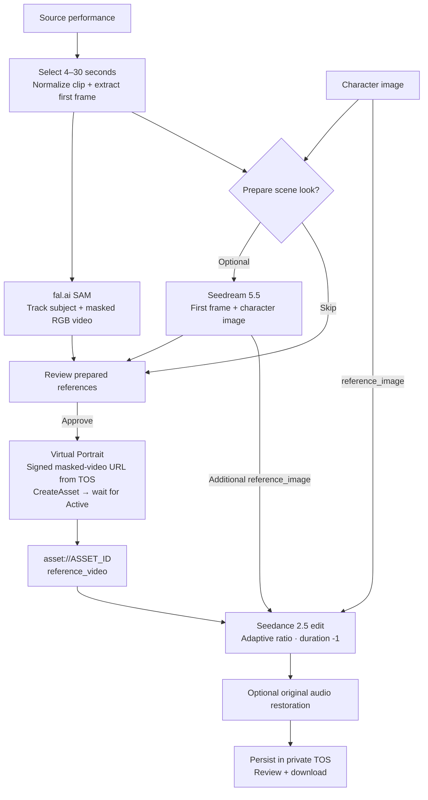

# Recast Studio

A private character-swap studio: bring a performance, add a character, direct the transformation.

Next.js 16, React 19, TypeScript, Tailwind 4, shadcn/ui, Axios, TanStack Query, React Hook Form and Zod. PostgreSQL stores accounts and a durable processing queue. A separate Node worker runs FFmpeg, fal.ai SAM and BytePlus generation. **BytePlus TOS stores production media.**

## Workflow



Scene-image preparation is optional. The original first frame is extracted before masking. Its Seedream edit becomes an additional image reference, without mixing a native first_frame role with an omni video reference. No LoRA training is involved.

## Local setup

Requirements: Node.js 24+, Docker, FFmpeg and ffprobe.

```sh
npm ci
npm run setup
docker compose --env-file .env.local up -d db
npm run db:migrate
npm run dev
```

In a second terminal:

```sh
npm run worker
```

Open **http://localhost:3107**, create an account and upload your references. Local storage mode supports development, previews and job persistence. For live processing, set STORAGE_MODE=tos and add provider credentials.

Setup creates random secrets, writes an absolute media directory, and preserves an existing environment file. Local registration starts enabled. Before hosting, configure an invite code, create your accounts, then set REGISTRATION_ENABLED=false.

## Configuration

| Variable                                   | Purpose                                                             |
| ------------------------------------------ | ------------------------------------------------------------------- |
| BYTEPLUS_API_KEY                           | ModelArk bearer key for Seedance and optional Seedream              |
| SEEDANCE_MODEL                             | Default dreamina-seedance-2-5-260628; confirm account access        |
| FAL_KEY                                    | Server-side fal.ai key                                              |
| FAL_SAM_ENDPOINT                           | Default fal-ai/sam-3-1/video; replace with your compatible endpoint |
| BYTEPLUS_ACCESS_KEY, BYTEPLUS_SECRET_KEY   | Separate Virtual Portrait OpenAPI credentials                       |
| BYTEPLUS_SESSION_TOKEN                     | Optional STS token                                                  |
| BYTEPLUS_PROJECT                           | Default project name: default                                       |
| BYTEPLUS_ASSET_GROUP                       | Optional existing AIGC group; otherwise created and saved per user  |
| SEEDREAM_MODEL                             | Optional **verified Seedream 5.5 model/endpoint ID**                |
| STORAGE_MODE=tos                           | Native TOS SDK and signed media URLs                                |
| TOS_ACCESS_KEY, TOS_SECRET_KEY, TOS_BUCKET | Private bucket credentials                                          |
| TOS_SESSION_TOKEN                          | Optional TOS STS token                                              |
| TOS_REGION                                 | Default ap-southeast-1; match ModelArk's region                     |
| TOS_ENDPOINT                               | Default tos-ap-southeast-1.bytepluses.com                           |
| APP_URL                                    | Exact browser origin for request validation                         |
| SESSION_SECRET                             | At least 32 random characters                                       |
| INVITE_CODE                                | Registration gate                                                   |
| MAX_DAILY_JOBS, MAX_ACTIVE_JOBS            | Per-user job limits                                                 |

Use a **public TOS endpoint** because fal.ai and browsers cannot access internal TOS URLs. Objects stay private, with signed GET access for six hours and AES256 server-side encryption requested on uploads. Configure bucket permissions accordingly. No AWS S3 service is required. When switching an existing local-only workspace to TOS, re-upload its references; local files are not automatically migrated.

The Seedream 5.5 API ID has not been verified for this account. Its optional control stays disabled until explicitly configured and never silently falls back to another model.

The fal adapter expects SAM 3.1 video inputs (video_url, subject prompt, apply_mask=true) and an MP4 result at video.url. Adjust src/server/fal.ts if the supplied endpoint uses a different schema.

Virtual Portrait acceptance of SAM-masked clips needs live verification. Masking does not guarantee eligibility. The worker waits for an Active asset and surfaces rejection.

## Production

```sh
npm run setup
# Configure .env.local: provider keys, TOS, APP_URL and invite policy.
docker compose --env-file .env.local up --build -d
```

Compose starts PostgreSQL 18, an idempotent migration, a web server and a separate worker, with persistent database and shared media-cache volumes. Web and worker must share the same absolute MEDIA_ROOT; Compose sets /app/.data. Port 3107 binds to loopback. Add an HTTPS reverse proxy and set APP_URL to its origin. Production cookies require HTTPS outside localhost.

The worker requires long-running Node and FFmpeg. A web-only Vercel deployment cannot run this complete architecture. Back up PostgreSQL and TOS, restrict provider keys, and configure media retention. This release is a private studio without billing or password-reset email.

## Validation

```sh
npm run lint
npm run typecheck
npm test
npm run build
```

For actual endpoint and worker checks, use a disposable app/database with registration enabled and **FAL_KEY unset**. Start the server and worker, then run:

```sh
npm run smoke
```

Checks create and remove their own accounts/media. They exercise authentication, cross-user isolation, invalid inputs, real uploads and media reads, FFmpeg trim/first-frame/audio persistence, history, cancellation and interrupted-submission recovery. TOS mode also verifies a signed range download. No provider responses are mocked; paid generation is deliberately not submitted.

GitHub Actions runs these checks with real PostgreSQL, FFmpeg and the production server/worker in local mode. See [validation evidence](docs/validation.md) for completed checks and pending provider verification.

## Implementation

- src/components/: studio, upload/auth flows and shadcn primitives.
- src/lib/: shared Zod contracts, Axios client and typed API methods.
- src/server/: auth, owner-scoped media/jobs, TOS and provider adapters.
- src/app/api/: authenticated route handlers.
- scripts/worker.ts: leased queue and generation lifecycle.
- db/001_initial.sql: persistent schema.
- tests/: provider contract and validation regression tests.

Sessions use opaque random tokens hashed at rest, HttpOnly cookies, origin checks and durable rate limits. Every media/job lookup checks ownership. Account changes clear the browser query cache. Provider keys stay on the server.

The worker saves a marker before provider mutations. An interrupted submission stops for manual inspection instead of automatically creating another billable task. Inspect fal.ai/ModelArk before starting a replacement run. Cancellation after provider acceptance is best effort and may not prevent billing.

## Sources

- [BytePlus video API](https://docs.byteplus.com/en/docs/modelark/create-video-generation-task-api): timing, reference roles and input limits.
- [Virtual Portrait](https://docs.byteplus.com/en/docs/modelark/private-virtual-avatar-library-guide-preview).
- [BytePlus image API](https://docs.byteplus.com/en/docs/modelark/image-generation-api).
- [Seedream 5.5](https://ai.byteplus.com/lumina/en/image/seedream-5-5).
- [fal.ai SAM 3.1](https://fal.ai/models/fal-ai/sam-3-1/video/api).
- [TOS Node SDK](https://docs.byteplus.com/api/docs/tos/Install-the-node-js-sdk).
- [TOS metadata](https://docs.byteplus.com/en/docs/tos/Manage-object-meta-information-node-js-sdk).
- [TOS signed URLs](https://docs.volcengine.com/docs/torch-object-storage/standard-presigned-url-nodejs-sdk?lang=en).
- [Next.js standalone output](https://nextjs.org/docs/app/api-reference/config/next-config-js/output).
- [Comfy Openjutsu](https://github.com/Comfy-Org/comfy-openjutsu): original workflow research.
- [Unsplash photograph](https://images.unsplash.com/photo-1534528741775-53994a69daeb): decorative character idea, not a generated output.
