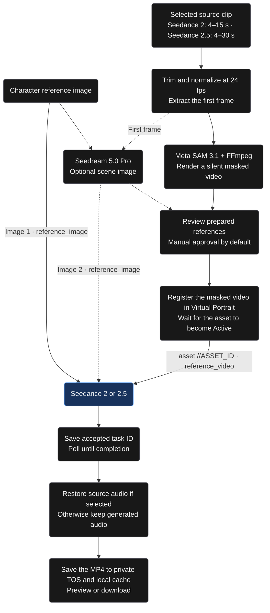
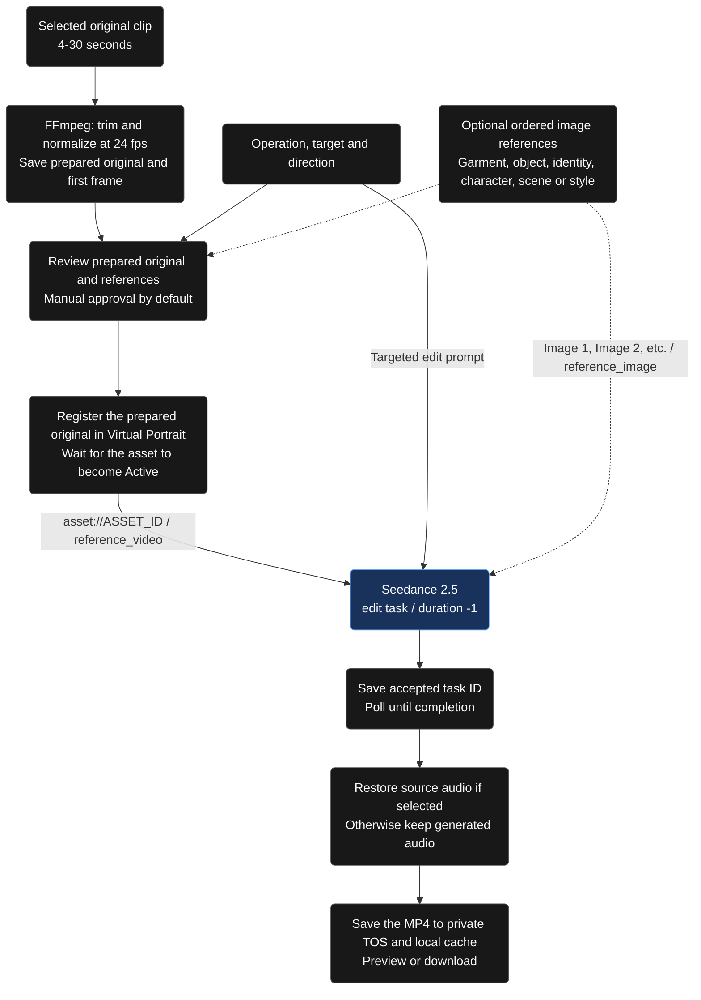
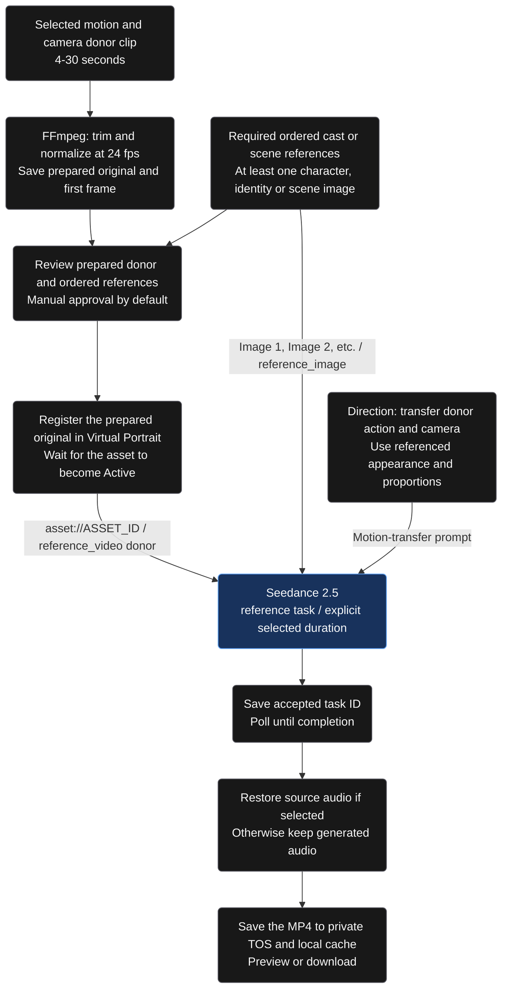
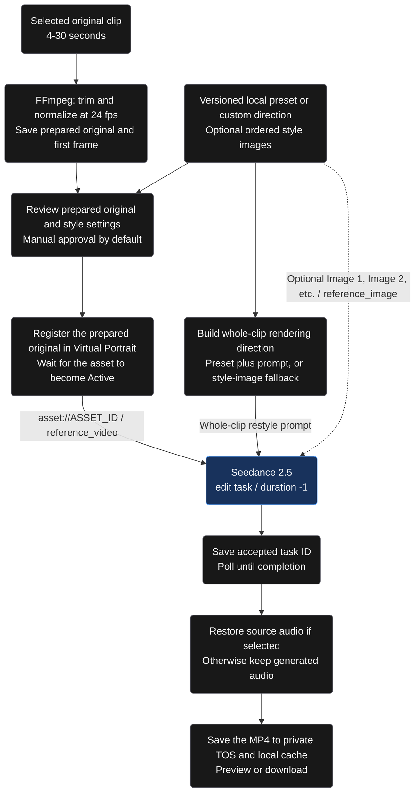
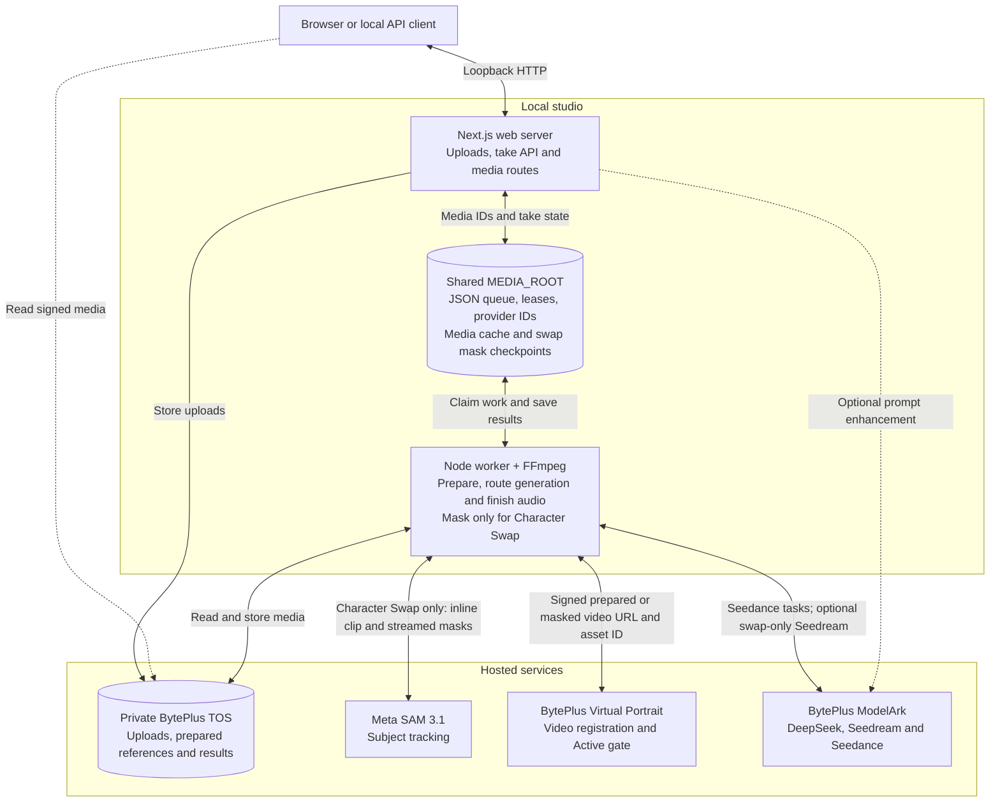
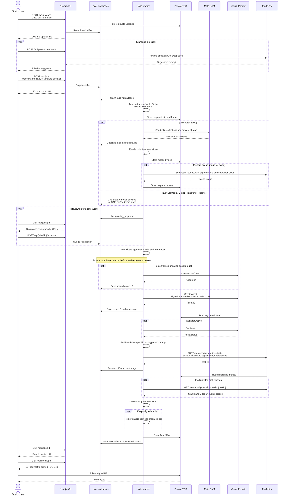

# Seed Genjutsu

A local, single-user video transformation studio with four workflows: **Character Swap**, **Edit Elements**, **Motion Transfer**, and **Restyle**. Choose the transformation, upload a source clip and any required references, review the prepared inputs, and generate with BytePlus ModelArk.

The studio opens without accounts, login, cookies, or a database. Next.js 16, React 19, and a separate Node/FFmpeg worker share a durable JSON workspace on this computer. Live generation uses private BytePlus TOS and Virtual Portrait. **Only Character Swap uses Meta SAM; the other three workflows use the prepared original video.**

[Choose a workflow](#choose-a-workflow) · [Run locally](#run-locally) · [Use the studio](#use-the-studio) · [Generation flows](#workflow-generation-flows) · [Architecture](#architecture) · [API examples](#submit-a-take-through-the-api) · [Provider setup](#provider-configuration) · [Scope and limits](#scope-and-limits)

## Choose a workflow

| Workflow                                            | Use it for                                                                     | Required input                                                         | Video model       |
| --------------------------------------------------- | ------------------------------------------------------------------------------ | ---------------------------------------------------------------------- | ----------------- |
| [Character Swap](#character-swap-generation-flow)   | Replace a tracked subject with a character reference.                          | Source video and one replacement character image.                      | Seedance 2 or 2.5 |
| [Edit Elements](#edit-elements-generation-flow)     | Replace, add, remove, or modify people, wardrobe, objects, text, or locations. | Source video, operation, target, and direction. Images are optional.   | Seedance 2.5      |
| [Motion Transfer](#motion-transfer-generation-flow) | Use source action and camera movement to animate referenced cast or scenery.   | Source video and at least one character, identity, or scene image.     | Seedance 2.5      |
| [Restyle](#restyle-generation-flow)                 | Change the whole clip's rendering treatment.                                   | Source video plus a preset, custom direction, or style-image guidance. | Seedance 2.5      |

Each workflow has a dedicated generation flow below, a studio input panel, saved takes, reusable references/settings, and an API request example. These are application workflows over BytePlus APIs, not new models or a guarantee of preservation, output quality, or Higgsfield parity. See the [detailed workflow contracts](docs/workflows.md).

## Run locally

Requirements: Node.js 24+, FFmpeg and ffprobe. Docker is optional.

```sh
npm ci
npm run setup
npm run dev
```

In a second terminal:

```sh
npm run worker
```

Open **[http://localhost:3107](http://localhost:3107)**. Uploads and Your takes work immediately. Configure [provider connections](#provider-configuration) in your existing `.env` or `.env.local` before creating a live generation, and set `STORAGE_MODE=tos`. Live workflows need the ModelArk key, TOS/Virtual Portrait credentials, a private bucket, and the worker. Meta credentials are needed only for Character Swap. The [interactive preview](#interactive-preview) exercises all four modes without provider calls.

For a local production build, run `npm run build` followed by `npm run start`, and use `npm run worker:production` in the second terminal. Web and worker use the Next.js environment loader, including references such as `${BYTEPLUS_ACCESS_KEY}`. `npm run worker` defaults to development; `worker:production` explicitly matches the production web server. Shell variables take precedence, followed by `.env.<mode>.local`, `.env.local`, `.env.<mode>`, and `.env`. Production startup also prepares standalone static assets and binds to loopback. Restart both processes after changing credentials.

Setup preserves existing `.env`, `.env.local`, or development/production environment files without creating a higher-priority blank override. On a fresh installation it creates `.env.local` with owner-only permissions. There is no database process, migration, session secret or registration step. Old database/auth variables in an existing environment file are ignored.

## Use the studio

1. Choose a workflow in the settings panel, then upload the source video.
2. Select the clip range, model, resolution, and audio mode.
3. Add the workflow's required references and direction: a replacement character for Swap, an operation/target for Edit Elements, cast/scene references for Motion Transfer, or rendering guidance for Restyle.
4. For ordered images, choose roles and arrange them as Image 1, Image 2, and so on. Optionally enhance the direction, then edit the suggestion.
5. Create the take. The worker prepares the source; only Character Swap performs subject masking and optional scene-image generation.
6. Review the actual prepared media and settings. Approve to register the video and generate, or cancel the take.
7. Watch progress, play or download the result, and reuse saved inputs/settings for another take.

### Shared settings

| Setting             | Behavior                                                                                                                                                                                                               |
| ------------------- | ---------------------------------------------------------------------------------------------------------------------------------------------------------------------------------------------------------------------- |
| Workflow and model  | Workflow selects preparation and prompt/task routing. Model selects the configured provider binding. Edit Elements, Motion Transfer, and Restyle require Seedance 2.5. New Character Swap takes default to Seedance 2. |
| Clip range          | Seedance 2 uses whole-second 4-15 second selections. Seedance 2.5 uses 4-30 seconds. FFmpeg trims and normalizes the selected original to 24 FPS.                                                                      |
| Resolution          | Choose 480p, 720p, or 1080p. Provider requests use adaptive aspect ratio.                                                                                                                                              |
| Keep original audio | Default for every workflow. Sends `generate_audio: false` and restores the selected source soundtrack after generation, or silence when the source has no audio.                                                       |
| Generate new audio  | Sends `generate_audio: true` and retains Seedance's soundtrack. Motion/cadence changes can affect synchronization in either mode.                                                                                      |
| Review              | Enabled by default. Swap shows the masked performance; the other workflows show the prepared original. References and settings remain part of review.                                                                  |
| Scene preparation   | Optional, Character Swap only. Requires Seedream and adds a generated scene reference. All other modes reject `prepareImage: true`.                                                                                    |
| Saved takes         | Saved takes retain the workflow and resolved provider binding. Input reuse restores the selected model, trim, direction, ordered references, and settings for a new take.                                              |

### References and direction

Character Swap uses its dedicated replacement image input. Edit Elements, Motion Transfer, and Restyle support up to 30 ordered image references with roles `character`, `identity`, `garment`, `object`, `scene`, and `style`. Roles become numbered prompt guidance; the provider receives every image with `role: "reference_image"`. Reference order defines Image 1, Image 2, and so on. Duplicate image/reference IDs, unknown roles, and missing media are rejected.

Write a specific direction naming the requested change and what should remain. **Enhance prompt** is optional and workflow-aware; it does not generate video or remove the need to review the suggestion. Prompt instructions request preservation, but do not guarantee exact identity, text, timing, or geometry in the generated output.

Restyle presets are `custom`, `watercolor`, `anime`, `clay`, `noir`, and `pixel_art`, at revision `1`. They are versioned local creative directions, not extra models or qualified effects. Preset-only and style-image-only Restyle can use an empty custom prompt. Custom direction without those inputs needs at least ten characters.

## Workflow generation flows

All four workflows register their selected reference video with Virtual Portrait, wait for Active, and pass its `asset://` URI to Seedance as `role: "reference_video"`. **Active is processing status, not evidence of verified real-person authorization.** Registering a video does not establish eligibility of every image reference.

| Workflow                       | Registered video        | Provider task routing                                       | Provider duration          |
| ------------------------------ | ----------------------- | ----------------------------------------------------------- | -------------------------- |
| Character Swap on Seedance 2   | SAM-masked performance  | Reference generation; omit the 2.5-only task-type parameter | Explicit selected duration |
| Character Swap on Seedance 2.5 | SAM-masked performance  | `omni_reference_task_type: "edit"`                          | `-1`, adaptive timing      |
| Edit Elements                  | Prepared original       | `omni_reference_task_type: "edit"`                          | `-1`, adaptive timing      |
| Motion Transfer                | Prepared original donor | `omni_reference_task_type: "reference"`                     | Explicit selected duration |
| Restyle                        | Prepared original       | `omni_reference_task_type: "edit"`                          | `-1`, adaptive timing      |

The configured model fields resolve the provider bindings. Every take pins its resolved model and accepted provider IDs. The flows follow [workflow contracts](src/lib/workflows.ts), the [transformation request builder](src/server/generation.ts), [approval/media validation](src/server/jobs.ts), and the [worker](scripts/worker.ts).

The diagrams show successful takes with review enabled. Cancellation stops the take; invalid inputs and provider failures are reported. Accepted IDs remain available for recovery. Interrupted submissions without a saved ID stop for inspection instead of being blindly repeated. See [local persistence](#local-persistence).

### Character-swap generation flow

Choose a clear replacement image and a **Subject to replace** phrase describing visible source attributes, such as `person in a black jacket`. SAM receives that phrase, not the creative direction. The masked performance guides motion and camera; the character image guides appearance and body proportions. The silhouette remains a competing visual cue, so generated proportions can vary.

Optionally enable scene preparation to use Seedream 5.0 Pro: Image 1 is the character, and the extracted source frame guides the generated scene that becomes Image 2. This is an additional paid stage, not a requirement for swapping. See [SAM integration and recovery](docs/meta-sam.md) for bounded inline video, mask parsing, and detailed subject-prompt guidance.



### Edit Elements generation flow

Choose `replace`, `add`, `remove`, or `modify`, describe the target, and write the change. Optional garment/object/scene images can guide appearance. For example: `Change only the jacket to red; keep the person's identity, pose, and gallery.` Wardrobe-only instructions request clothing changes without recasting the person. Literal text is retained in the submitted prompt, but generated typography may vary.

`element_edit` uses the prepared original as the editing reference. There is no SAM mask or Seedream scene image.



### Motion Transfer generation flow

Upload movement/camera donor footage and at least one `character`, `identity`, or `scene` reference. Arrange the images and describe their roles: `Animate the character in Image 1 using Video 1's action and camera movement.` Referenced cast or scenery can replace the donor appearance.

`motion_transfer` asks Seedance to adapt donor movement to the referenced body proportions, rather than edit a SAM silhouette. It uses an explicit output duration; action, temporal fidelity, and audio synchronization still need qualification on representative footage.



### Restyle generation flow

Choose a preset, write a custom rendering direction, or supply style images. For example: select **Watercolor** without a custom prompt, or write `Render the whole clip as ink animation while keeping the composition.` The treatment applies to both subjects and surroundings.

`restyle` combines preset direction with the custom prompt; style-image-only requests use a fallback direction. Style references guide rendering rather than recasting the subject. No SAM, Seedream, or other image-generation stage is called; temporal consistency is a quality target, not a guarantee.



## Architecture

**All four workflows share the same local web/worker architecture.** The web server and worker run on the same machine and coordinate through `MEDIA_ROOT`, not an in-memory queue or a database. This view shows live generation with private BytePlus TOS storage.



`BYTEPLUS_API_KEY` authenticates ModelArk generation and enhancement. The separate IAM AK/SK pair, with a session token when using STS, signs TOS and Virtual Portrait operations. `META_API_KEY` is needed only for the Character Swap masking path. Keys remain in server/worker environments; browsers receive local media IDs and expiring signed media URLs, not provider credentials. See [provider configuration](#provider-configuration).

### Data sequence

This sequence follows a successful take through the shared APIs, with the **Character Swap-only branch** shown explicitly. The client polls the take URL for progress; reference review is enabled by default.



The job API returns before provider generation starts. The renewable worker lease owns each stage; atomic workspace updates preserve accepted IDs and subsequent stages. Registration and generation failures, cancellation, and ambiguous submissions follow the [local persistence and recovery rules](#local-persistence). The shared architecture applies to every workflow, while SAM and optional Seedream remain inside the Character Swap branch.

## Submit a take through the API

The studio and local API use the same workflow contracts and worker. Upload the source through `POST /api/uploads` with multipart fields `kind: "video"` and `file`. Upload images with `kind: "character"`; that transport name applies to all semantic image roles. Use returned `upload.id` values, not arbitrary URLs, provider asset IDs, or the illustrative UUIDs below.

| Endpoint                                 | Purpose                                                                       |
| ---------------------------------------- | ----------------------------------------------------------------------------- |
| `POST /api/uploads`                      | Validate/store a video or image and return `upload.id`.                       |
| `POST /api/jobs`                         | Validate workflow inputs and enqueue a take.                                  |
| `GET /api/jobs` and `GET /api/jobs/{id}` | Read history, configuration, references, progress, and results.               |
| `POST /api/jobs/{id}/approve`            | Continue an awaiting-review take.                                             |
| `POST /api/jobs/{id}/cancel`             | Request cancellation without losing accepted provider IDs.                    |
| `GET /api/media/{id}`                    | Stream local media or redirect to a signed private TOS read.                  |
| `GET /api/capabilities`                  | Report workflow/provider configuration readiness, not entitlement or quality. |
| `GET /api/presets?workflow=restyle`      | Discover versioned local presets and `qualityValidated: false`.               |
| `POST /api/prompts/enhance`              | Request an optional editable, workflow-aware prompt suggestion.               |

### Character Swap request

Use the dedicated `characterId` input. This selects Seedance 2.5 explicitly; new swaps default to Seedance 2 when `model` is omitted. Set `prepareImage: true` only when optional Seedream scene preparation is intended and configured.

```json
{
  "workflow": "character_swap",
  "sourceId": "aaaaaaaa-aaaa-4aaa-aaaa-aaaaaaaaaaaa",
  "characterId": "bbbbbbbb-bbbb-4bbb-bbbb-bbbbbbbbbbbb",
  "prompt": "Replace the performer with the reference character.",
  "target": "person in a black jacket",
  "model": "seedance-2.5",
  "start": 0,
  "duration": 4,
  "resolution": "480p",
  "preserveAudio": true,
  "prepareImage": false,
  "reviewBeforeGeneration": true
}
```

### Edit Elements request

A video-only targeted edit. Add ordered references when images should guide the requested change.

```json
{
  "workflow": "element_edit",
  "sourceId": "aaaaaaaa-aaaa-4aaa-aaaa-aaaaaaaaaaaa",
  "model": "seedance-2.5",
  "operation": "modify",
  "target": "the charcoal jacket",
  "prompt": "Change only the jacket to red. Preserve identity, pose, gallery and camera movement.",
  "references": [],
  "start": 0,
  "duration": 4,
  "resolution": "480p",
  "preserveAudio": true,
  "prepareImage": false,
  "reviewBeforeGeneration": true
}
```

### Motion Transfer request

Use ordered `references`, not `characterId`. Each reference has a unique `id`, an uploaded `mediaId`, and a semantic `role`; at least one must be `character`, `identity`, or `scene`.

```json
{
  "workflow": "motion_transfer",
  "sourceId": "aaaaaaaa-aaaa-4aaa-aaaa-aaaaaaaaaaaa",
  "model": "seedance-2.5",
  "prompt": "Animate the character in Image 1 using Video 1's action and camera movement. Keep the referenced appearance and body proportions.",
  "references": [
    {
      "id": "cccccccc-cccc-4ccc-accc-cccccccccccc",
      "mediaId": "bbbbbbbb-bbbb-4bbb-bbbb-bbbbbbbbbbbb",
      "role": "character"
    }
  ],
  "start": 0,
  "duration": 4,
  "resolution": "480p",
  "preserveAudio": true,
  "prepareImage": false,
  "reviewBeforeGeneration": true
}
```

### Restyle request

Preset-only watercolor needs no image or custom prompt. For custom/style-image requests, use `stylePreset: "custom"` and provide a direction or ordered `style` references.

```json
{
  "workflow": "restyle",
  "sourceId": "aaaaaaaa-aaaa-4aaa-aaaa-aaaaaaaaaaaa",
  "model": "seedance-2.5",
  "stylePreset": "watercolor",
  "stylePresetRevision": 1,
  "prompt": "",
  "references": [],
  "start": 0,
  "duration": 4,
  "resolution": "480p",
  "preserveAudio": true,
  "prepareImage": false,
  "reviewBeforeGeneration": true
}
```

The [full API contract](docs/workflows.md#api) covers media limits, image roles, unknown-field rejection, and preset discovery. The three SAM-free modes require Seedance 2.5 and reject both `characterId` and `prepareImage: true`.

### Approval and progress

`reviewBeforeGeneration: false` authorizes the worker to continue from preparation through generation without a second submission. The API returns `202 Accepted` with `job.id` and a `Location` header for `GET /api/jobs/{id}`. Poll until `job.status` is `succeeded` and read `job.result.url`, or stop on `failed`, `cancelled`, or `needs_attention`. Send `POST /api/jobs/{id}/cancel` to request cancellation.

Review defaults to `true` for existing callers and the studio. In that mode, poll for `awaiting_approval`, then send `POST /api/jobs/{id}/approve` to continue. Review `job.prepared` for the three new modes and `job.masked` for Character Swap. The API runs on the local studio's loopback address.

### Compatibility

Requests and saved records without `workflow` mean `character_swap`. Legacy requests retain `characterId` and existing unknown-field stripping; explicit non-swap requests reject unknown fields. Saved pre-picker takes remain on Seedance 2.5, while new Character Swap takes default to Seedance 2. Saved provider model/task/asset IDs are not silently replaced when configuration changes.

## Local persistence

Web and worker must resolve MEDIA_ROOT to the same directory. Production startup resolves a relative value from the project folder before standalone changes its working directory; start the worker from that project folder too. Setup writes an absolute path explicitly; Compose uses /app/.data.

| Location                  | Contents                                                                                  |
| ------------------------- | ----------------------------------------------------------------------------------------- |
| MEDIA_ROOT/workspace.json | Media index, takes, events, provider IDs, submission markers, worker leases and heartbeat |
| MEDIA_ROOT/UUID           | Uploaded and prepared media; a local cache when TOS is enabled                            |
| MEDIA_ROOT/sam/UUID.json  | Completed Meta mask checkpoints, used to recover rendering without another API request    |
| MEDIA_ROOT/demo/local/    | Separate, opt-in mock workspace and its illustrative outputs                              |

Reads and writes use an inter-process file lock. Updates validate the document, sync a temporary file and atomically rename it. Corrupt state is reported; it is never silently reset. Provider submission markers are saved before external mutations. Accepted asset/task/result IDs and their next stages are committed together. Older interrupted records that already contain an ID resume review, polling, or completion without submitting again. Responses interrupted before any ID was saved remain ambiguous and stop for manual inspection. Cancellation retains any accepted provider ID.

Back up MEDIA_ROOT while both processes are stopped, together with the private TOS objects when configured. This implementation is designed for one computer and a modest local library. It rewrites one JSON index per update; multi-host coordination and larger catalogs belong to the future database work.

The app binds to 127.0.0.1. API checks reject foreign origins, cross-site requests and non-loopback Host headers. All requests on this computer share one studio. Add authentication before network hosting.

JSON bodies are limited to 32,000 counted bytes. Multipart uploads are limited to 105 MiB total, with per-file limits of 100 MiB for video and 20 MiB for images. Limits also apply without `Content-Length`; oversized streams are cancelled. Invalid multipart requests return a client error. Local and preview playback stream bounded byte ranges rather than loading entire files, and disconnects close the media stream.

`GET /api/health` checks web persistence liveness. `GET /api/health?worker=1` also requires a worker heartbeat within 30 seconds and returns 503 otherwise. Both include `workerSeenAt`; the UI remains accessible when the worker stops. Compose checks the worker heartbeat separately.

## Provider configuration

Configure services according to the selected workflow; Meta and Seedream are not prerequisites for the entire studio.

| Service                                     | Character Swap              | Edit Elements          | Motion Transfer        | Restyle                |
| ------------------------------------------- | --------------------------- | ---------------------- | ---------------------- | ---------------------- |
| Seedance / ModelArk key                     | Required, Seedance 2 or 2.5 | Required, Seedance 2.5 | Required, Seedance 2.5 | Required, Seedance 2.5 |
| Private TOS and Virtual Portrait IAM access | Required                    | Required               | Required               | Required               |
| Meta SAM key                                | Required                    | Not used               | Not used               | Not used               |
| Seedream model                              | Optional scene preparation  | Not used               | Not used               | Not used               |
| DeepSeek prompt enhancer                    | Optional                    | Optional               | Optional               | Optional               |

| Variable                                     | Purpose                                                                            |
| -------------------------------------------- | ---------------------------------------------------------------------------------- |
| `BYTEPLUS_API_KEY`                           | ModelArk bearer key                                                                |
| `PROMPT_ENHANCER_MODEL`                      | Optional prompt text model; defaults to `deepseek-v4-1-flash-261017`               |
| `SEEDANCE_2_MODEL`                           | Seedance 2 binding; defaults to `dreamina-seedance-2-0-260128`                     |
| `SEEDANCE_2_5_MODEL`                         | Seedance 2.5 binding; defaults to `dreamina-seedance-2-5-260628`                   |
| `META_API_KEY`                               | Character Swap only: Meta Model API key with SAM 3.1 access; model `sam-3.1`       |
| `BYTEPLUS_ACCESS_KEY`, `BYTEPLUS_SECRET_KEY` | Shared BytePlus IAM credentials for TOS and Virtual Portrait OpenAPI               |
| `BYTEPLUS_SESSION_TOKEN`                     | Optional STS token shared by TOS and Virtual Portrait                              |
| `BYTEPLUS_PROJECT`                           | Defaults to `default`                                                              |
| `BYTEPLUS_ASSET_GROUP`                       | Optional existing AIGC group; otherwise its ID is saved in the local workspace     |
| `SEEDREAM_MODEL`                             | Optional Character Swap scene image: `dola-seedream-5-0-pro-260628`                |
| `STORAGE_MODE`                               | `local` for development; `tos` for signed provider references                      |
| `TOS_BUCKET`                                 | Private TOS bucket; uses the shared BytePlus IAM credentials                       |
| `TOS_REGION`, `TOS_ENDPOINT`                 | Match the bucket region; default `ap-southeast-1` and its public BytePlus endpoint |
| `APP_URL`                                    | Loopback browser origin, default `http://localhost:3107`                           |
| `MEDIA_ROOT`                                 | Absolute directory shared by web and worker                                        |
| `MAX_DAILY_JOBS`, `MAX_ACTIVE_JOBS`          | Local safeguards against accidental duplicate or excessive generation              |

Use a public TOS endpoint so BytePlus and the browser can read signed references. For Character Swap, Meta SAM receives bounded inline prepared-video bytes because its fetch service rejected the signed TOS URL. The three new workflows skip Meta entirely. Objects remain private and signed GET URLs expire after six hours; uploads request AES256 server-side encryption. Provider keys remain server-side.

Configure `BYTEPLUS_ACCESS_KEY` and `BYTEPLUS_SECRET_KEY` once for both TOS and Ark/Virtual Portrait. The IAM identity must have access to the configured bucket and the required Virtual Portrait asset operations; sharing credentials does not grant additional permissions. Keep permissions scoped to the resources this studio needs. Temporary credentials also share `BYTEPLUS_SESSION_TOKEN`; rotate all three together and restart the web server and worker. `BYTEPLUS_API_KEY` remains a separate ModelArk bearer key.

For existing installations, migrate the chosen IAM pair to `BYTEPLUS_ACCESS_KEY` / `BYTEPLUS_SECRET_KEY` and its STS token, if any, to `BYTEPLUS_SESSION_TOKEN`. Remove the old `TOS_ACCESS_KEY`, `TOS_SECRET_KEY`, and `TOS_SESSION_TOKEN` settings; they are no longer read. TOS bucket, region, and endpoint settings are unchanged.

Both video models share `BYTEPLUS_API_KEY`. Confirm account entitlement for each selected binding. Existing local configuration has been moved from `SEEDANCE_MODEL` to the two fields above; custom ModelArk endpoint IDs can be supplied per model. Provider configuration readiness does not prove deployment entitlement, portrait authorization, or output quality.

## Enhance your direction

Every workflow supports **Enhance prompt** below its direction field through BytePlus DeepSeek V4.1 Flash 1017 and Vercel AI SDK 7. The enhancer uses workflow, operation/preset, and ordered role metadata; it does not send reference media URLs. Edit the result, **Retry** from the original direction, or **Undo**. Newer edits are protected while a request runs. This optional action uses the ModelArk key and does not submit a video task. See [prompt enhancement](docs/prompt-enhancement.md).

## Interactive preview

Set `DEMO_ENABLED=true` and restart the web server. Open **[http://localhost:3107/preview](http://localhost:3107/preview)**, or select **Try sample** in the main studio. The sample workspace uses its own local file index, separate from real takes.

All four workflow panels, ordered references, presets, review, history, cancellation, and result downloads are available in the sample workspace. Its HTTP routes perform actual uploads, clip preparation, and downloads, but model stages are simulated and outputs are prerecorded. Changing the direction does not change the sample video. In **Sample settings**, choose **Sample outcome** to test success or failure. No Meta, ModelArk, Virtual Portrait, or TOS request is submitted from preview. The default flag is false.

[UI review and sample provenance](docs/ui-preview.md) contains exact checks and the built-in imagegen prompts.

## Optional containers

```sh
npm run setup
docker compose up --build -d
```

Compose starts only web and worker, sharing one media volume; the published port binds to loopback. It reads `.env` and then `.env.local` when present. FFmpeg is included in the image. There is no database or migration service.

An earlier prototype used PostgreSQL. Its old Docker database volume and files are left untouched and are not read or automatically migrated by this version. Existing mock session folders are likewise preserved. Re-upload references into the current local studio when needed.

## Validation

```sh
npm run lint
npm test
npm run build
npm run typecheck
```

After building, run the self-contained runtime checks. No existing server, workspace, or provider configuration is used:

```sh
npm run smoke
npm run demo:smoke
npm run smoke:container
```

`npm run smoke` owns a temporary workspace and web/worker processes on a free loopback port, blanks every provider key, checks the target's random instance ID and live-provider capabilities before mutations, and removes its processes and generated data afterward. It checks account-free access, removed auth routes, fixed-length/chunked request limits, uploads, FFmpeg persistence, history, quotas, approval, cancellation, and interrupted submissions, then runs the simulated preview checks. `demo:smoke` runs only the preview checks in its own disposable instance. Direct check-script execution without ownership is refused.

`smoke:container` requires a running Docker daemon. It builds the shipped image using a separate credential-free Compose configuration and unique disposable volumes, runs both checks, verifies worker readiness expires while web liveness remains healthy, stops both services, exports a volume backup, restores into a new volume, compares file hashes, and verifies persisted media after restart. Temporary containers, volumes, and backups are removed. GitHub Actions runs both native and container checks.

The [live browser test](docs/validation.md#live-internet-footage-test--2026-11-08) completed Seedance 2 and 2.5 takes from moving Blender footage using private TOS, Meta SAM, Virtual Portrait and optional Seedream. It verified original and generated audio, playback and browser downloads. A separate archival clip exposed a SAM tracking limit. [Higgsfield prompting research](docs/higgsfield-prompt-research.md) records the public evidence and prompt improvements.

The [new-workflow live tests](docs/validation.md#core-workflows-live-validation---2026-11-09) completed two separately approved batches: six distinct real Seedance 2.5 tasks covering Edit Elements, Motion Transfer, and Restyle. They used private TOS and Virtual Portrait without SAM, enhancement, or Seedream. Provider status, downloaded hashes, and full playback passed. The four-second fictional input is an animated still with silent audio, so these tests do not qualify articulated motion, dialogue sync, real-person eligibility, or all presets. Edit/restyle outputs measured about 3.7 seconds, not exactly the selected four seconds.

The [2026-11-07 pre-E2E review](docs/pre-e2e-review.md) fixed startup, media integrity and UI state races, with 30 focused tests and fresh runtime/browser checks.

## Scope and limits

- This release implements four workflows, not a social feed, motion library, native plugins, Lite tier, third-party provider integration, or general VFX catalog.
- Real-person eligibility, consent, and authorized-asset requirements still apply to video and images. An Active Virtual Portrait asset is not a substitute for those requirements.
- Identity/proportion fidelity, temporal restyling, exact text, articulated motion, and audio synchronization are model-quality concerns, not guarantees from a successful task or mux.
- Edit/restyle use adaptive duration. A four-second input can produce a shorter output; the tested samples measured about 3.7 seconds.
- Preset revisioning preserves creative intent, not qualification of every preset. Preview verifies UI/API behavior, not inference quality.
- Live processing incurs provider usage. Optional enhancement and swap scene preparation add model calls. Token telemetry is not a settled bill.
- The studio is local and single-user. Keep it on loopback; network hosting requires authentication and stronger isolation.

The [validation snapshot](docs/validation.md) distinguishes observed results from unqualified behavior. Further quality evaluation needs rights-cleared representative footage and separate approval for paid calls.

## Future database and authentication

The current scope is explicitly local and single-user. [Future auth and database note](docs/future-auth-and-database.md) records upgrade triggers, repository boundaries, a tenant-aware schema, session requirements and a safe import path. None of that infrastructure is required or implemented now.

## Implementation

- `src/components/`: four-workflow studio, role-tagged uploads, input reuse, review/results, and shadcn primitives.
- `src/lib/`: Zod contracts, workflow roles/presets, Axios client, and TanStack Query keys.
- `src/server/generation.ts`: Seedance 2.5 edit/reference builder for Edit Elements, Motion Transfer, and Restyle.
- `src/server/workspace.ts` and `json-file.ts`: validated persistence and process-safe writes.
- `src/server/jobs.ts`: take creation, approval, cancellation, and worker leases.
- `src/server/storage.ts`: local media and native private TOS storage.
- `src/server/providers.ts`: BytePlus provider contracts and signing.
- `src/server/meta-sam.ts` and `sam-render.ts`: Character Swap-only tracking, checkpoints, and mask rendering.
- `src/app/api/`: local HTTP handlers with request-origin/Host checks.
- `scripts/worker.ts`: shared preparation, workflow routing, registration, polling, and audio finishing.

## Sources

- [BytePlus video API](https://docs.byteplus.com/en/docs/modelark/create-video-generation-task-api): timing, reference roles and input limits.
- [Seedance 2](https://docs.byteplus.com/en/docs/ModelArk/seedance-2-0) and [Seedance 2.5](https://docs.byteplus.com/en/docs/ModelArk/seedance-2-5): model-specific reference and editing modes.
- [shadcn Select](https://ui.shadcn.com/docs/components/select): accessible model picker.
- [Virtual Portrait](https://docs.byteplus.com/en/docs/modelark/private-virtual-avatar-library-guide-preview).
- [BytePlus image API](https://docs.byteplus.com/en/docs/modelark/image-generation-api).
- Seedream 5.0 Pro model: `dola-seedream-5-0-pro-260628` (user-selected configuration).
- [Meta SAM 3.1](https://dev.meta.ai/models/sam-3-1), [segmentation API](https://dev.meta.ai/docs/sam/segmenting) and [official parser](https://dev.meta.ai/docs/sam/client-libraries).
- [TOS Node SDK](https://docs.byteplus.com/api/docs/tos/Install-the-node-js-sdk).
- [TOS metadata](https://docs.byteplus.com/en/docs/tos/Manage-object-meta-information-node-js-sdk).
- [TOS signed URLs](https://docs.volcengine.com/docs/torch-object-storage/standard-presigned-url-nodejs-sdk?lang=en).
- [Next.js standalone output](https://nextjs.org/docs/app/api-reference/config/next-config-js/output).
- [Next.js environment variables](https://nextjs.org/docs/app/guides/environment-variables): shared environment loading and variable references.
- [TanStack query cancellation](https://tanstack.com/query/latest/docs/framework/react/guides/query-cancellation): prevent in-flight detail/history reads from overwriting mutation updates.
- [Comfy Openjutsu](https://github.com/Comfy-Org/comfy-openjutsu): original workflow research.
- [Sample asset provenance](docs/ui-preview.md#sample-asset-provenance): built-in image generation and FFmpeg fixtures, independent of live BytePlus generation.
- The header and video model picker use the [BytePlus provider mark](https://sf-bpcms.bytepluscdn.com/obj/byteplus-public-aiso/portal/assets/apple-touch-icon.png) from the BytePlus website.

The product name, browser metadata, worker labels and new downloads use Seed Genjutsu. Storage prefixes, the preview request header and the Compose project name preserve compatibility with existing references and volumes.
