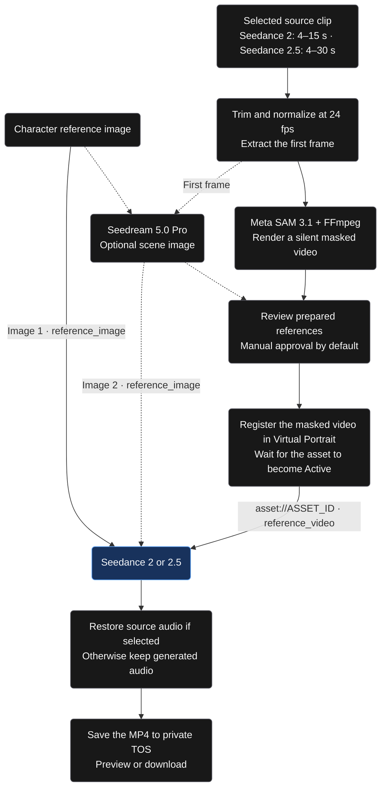
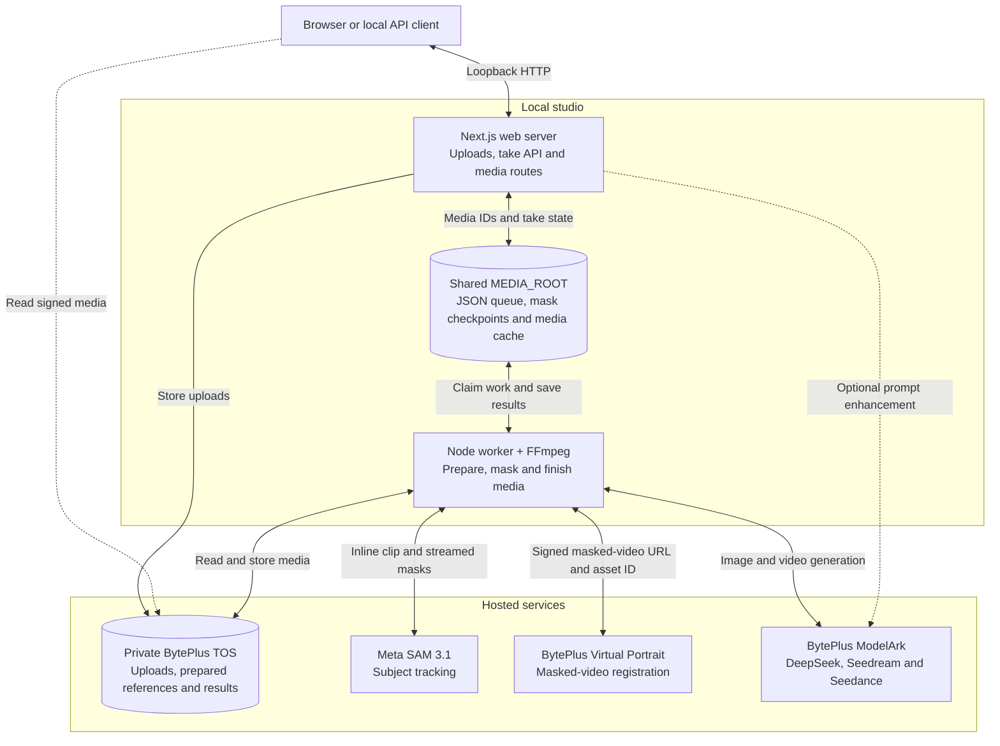
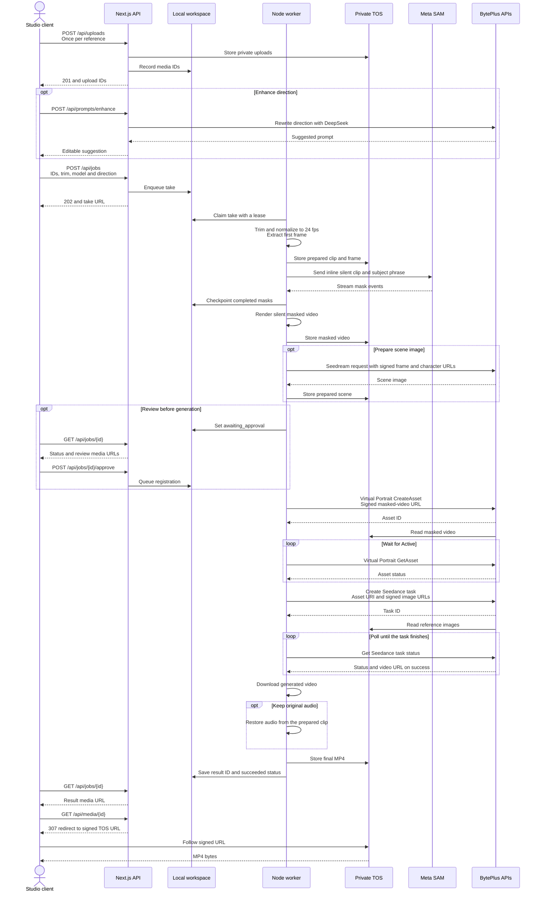

# Seed Genjutsu

A local, single-user character-swap studio: bring a performance, add a character, direct the transformation. The app opens directly without accounts, login, cookies or a database.

Next.js 16, React 19, TypeScript, Tailwind 4, shadcn/ui, Axios, TanStack Query, React Hook Form and Zod. JSON files store take history, media metadata and a worker queue on this computer. A separate Node worker runs Meta SAM 3.1, FFmpeg mask rendering and BytePlus generation. BytePlus TOS remains the object store for live provider references and finished media.

## Run locally

Requirements: Node.js 24+, FFmpeg and ffprobe. Docker is optional.

```sh
npm ci
npm run setup
npm run dev
```

In a second terminal:

```sh
npm run worker
```

Open **http://localhost:3107**. Uploads and Your takes work immediately. Configure provider connections in .env.local before creating a live generation. Set STORAGE_MODE=tos for live processing.

For a local production build, run `npm run build` followed by `npm run start`. The startup script loads `.env.local` with the same Next.js environment loader as the worker, including credential references such as `${BYTEPLUS_ACCESS_KEY}`. It also prepares standalone static assets and binds to loopback. Restart both processes after changing credentials.

Setup preserves an existing environment file and creates a private one when missing. There is no database process, migration, session secret or registration step. Old database/auth variables in an existing .env.local are ignored.

## Workflow

### Generation flow

The masked performance guides motion and camera. The character image guides appearance, with an optional prepared scene as a second image reference.



### Architecture

The web server and worker run on the same machine and coordinate through `MEDIA_ROOT`. This view shows live generation with private BytePlus TOS storage.



### Data sequence

This sequence follows a successful take. The client polls the take URL for progress, and reference review is enabled by default.



### Generation options

Scene-image preparation is optional. The worker extracts the first frame of the selected clip before masking. The Seedream edit becomes an additional image reference.

The shadcn model picker defaults new takes to **Seedance 2** for testing. Seedance 2 uses reference generation with a whole-second 4–15 second clip and explicit output duration; it omits the 2.5-only editing parameter. Seedance 2.5 uses the dedicated editing path with a 4–30 second clip, `omni_reference_task_type: edit`, and `duration: -1`. Switching to 2 shortens an oversized selection. Each take saves its model and resolved provider binding; history and variations retain the choice. Takes saved before this picker remain on 2.5. Both use adaptive aspect ratio and the approved Virtual Portrait video asset plus character image.

The character image guides the replacement's identity, outfit and visible body proportions. A clear full-body image provides the build, relative head size and limb lengths. The masked video guides movement, timing, placement and camera. Its silhouette still supplies a competing visual cue, so generated proportions can vary.

Choose **Keep original** (default) to restore the source soundtrack after generation, or **Generate new** to use Seedance dialogue and sound. Upload the clip as-is. The worker sends SAM a video-only copy and retains the prepared source audio for local finishing. The masked performance reference is silent.

## Submit a take through the API

Upload the video and character image through `POST /api/uploads` with multipart fields `kind` (`video` or `character`) and `file`. Use the returned `upload.id` values in one `POST /api/jobs` request:

```json
{
  "sourceId": "aaaaaaaa-aaaa-4aaa-aaaa-aaaaaaaaaaaa",
  "characterId": "bbbbbbbb-bbbb-4bbb-bbbb-bbbbbbbbbbbb",
  "prompt": "Replace the performer with the reference character.",
  "target": "performer in the orange spacesuit",
  "model": "seedance-2.5",
  "duration": 4,
  "resolution": "480p",
  "prepareImage": true,
  "reviewBeforeGeneration": false
}
```

`reviewBeforeGeneration: false` authorizes the worker to continue from preparation through generation without a second submission. The API returns `202 Accepted` with `job.id` and a `Location` header for `GET /api/jobs/{id}`. Poll until `job.status` is `succeeded` and read `job.result.url`, or stop on `failed`, `cancelled`, or `needs_attention`. Send `POST /api/jobs/{id}/cancel` to request cancellation.

Review defaults to `true` for existing callers and the studio. In that mode, poll for `awaiting_approval`, then send `POST /api/jobs/{id}/approve` to continue. The API runs on the local studio's loopback address.

## Local persistence

Web and worker must resolve MEDIA_ROOT to the same directory. Production startup resolves a relative value from the project folder before standalone changes its working directory; start the worker from that project folder too. Setup writes an absolute path explicitly; Compose uses /app/.data.

| Location                  | Contents                                                                                  |
| ------------------------- | ----------------------------------------------------------------------------------------- |
| MEDIA_ROOT/workspace.json | Media index, takes, events, provider IDs, submission markers, worker leases and heartbeat |
| MEDIA_ROOT/UUID           | Uploaded and prepared media; a local cache when TOS is enabled                            |
| MEDIA_ROOT/sam/UUID.json  | Completed Meta mask checkpoints, used to recover rendering without another API request    |
| MEDIA_ROOT/demo/local/    | Separate, opt-in mock workspace and its illustrative outputs                              |

Reads and writes use an inter-process file lock. Updates validate the document, sync a temporary file and atomically rename it. Corrupt state is reported; it is never silently reset. Provider submission markers are saved before external mutations so an interrupted response does not automatically create another paid task. The worker resumes queued work and expired leases after restart; ambiguous submissions stop for manual inspection.

Back up MEDIA_ROOT while both processes are stopped, together with the private TOS objects when configured. This implementation is designed for one computer and a modest local library. It rewrites one JSON index per update; multi-host coordination and larger catalogs belong to the future database work.

The app binds to 127.0.0.1. API checks reject foreign origins, cross-site requests and non-loopback Host headers. All requests on this computer share one studio. Add authentication before network hosting.

## Provider configuration

| Variable                                   | Purpose                                                                          |
| ------------------------------------------ | -------------------------------------------------------------------------------- |
| BYTEPLUS_API_KEY                           | ModelArk bearer key                                                              |
| PROMPT_ENHANCER_MODEL                      | Optional prompt text model; defaults to deepseek-v4-1-flash-261017               |
| SEEDANCE_2_MODEL                           | Seedance 2 binding; defaults to dreamina-seedance-2-0-260128                     |
| SEEDANCE_2_5_MODEL                         | Seedance 2.5 binding; defaults to dreamina-seedance-2-5-260628                   |
| META_API_KEY                               | Meta Model API key with SAM 3.1 access; model sam-3.1                            |
| BYTEPLUS_ACCESS_KEY, BYTEPLUS_SECRET_KEY   | Shared BytePlus IAM credentials for TOS and Virtual Portrait OpenAPI              |
| BYTEPLUS_SESSION_TOKEN                     | Optional STS token shared by TOS and Virtual Portrait                            |
| BYTEPLUS_PROJECT                           | Defaults to default                                                              |
| BYTEPLUS_ASSET_GROUP                       | Optional existing AIGC group; otherwise its ID is saved in the local workspace   |
| SEEDREAM_MODEL                             | Optional Seedream 5.0 Pro model ID: dola-seedream-5-0-pro-260628                 |
| STORAGE_MODE                               | local for development; tos for signed provider references                        |
| TOS_BUCKET                                 | Private TOS bucket; uses the shared BytePlus IAM credentials                      |
| TOS_REGION, TOS_ENDPOINT                   | Match the bucket region; default ap-southeast-1 and its public BytePlus endpoint |
| APP_URL                                    | Loopback browser origin, default http://localhost:3107                           |
| MEDIA_ROOT                                 | Absolute directory shared by web and worker                                      |
| MAX_DAILY_JOBS, MAX_ACTIVE_JOBS            | Local safeguards against accidental duplicate or excessive generation            |

Use a public TOS endpoint so BytePlus and the browser can read signed references. Meta SAM receives bounded inline prepared-video bytes because its fetch service rejected the signed TOS URL. Objects remain private and signed GET URLs expire after six hours; uploads request AES256 server-side encryption. Provider keys remain server-side.

Configure `BYTEPLUS_ACCESS_KEY` and `BYTEPLUS_SECRET_KEY` once for both TOS and Ark/Virtual Portrait. The IAM identity must have access to the configured bucket and the required Virtual Portrait asset operations; sharing credentials does not grant additional permissions. Keep permissions scoped to the resources this studio needs. Temporary credentials also share `BYTEPLUS_SESSION_TOKEN`; rotate all three together and restart the web server and worker. `BYTEPLUS_API_KEY` remains a separate ModelArk bearer key.

For existing installations, migrate the chosen IAM pair to `BYTEPLUS_ACCESS_KEY` / `BYTEPLUS_SECRET_KEY` and its STS token, if any, to `BYTEPLUS_SESSION_TOKEN`. Remove the old `TOS_ACCESS_KEY`, `TOS_SECRET_KEY`, and `TOS_SESSION_TOKEN` settings; they are no longer read. TOS bucket, region, and endpoint settings are unchanged.

Both video models share `BYTEPLUS_API_KEY`. Confirm account entitlement for each selected binding. Existing local configuration has been moved from `SEEDANCE_MODEL` to the two fields above; custom ModelArk endpoint IDs can be supplied per model.

Scene preparation is optional and uses Seedream 5.0 Pro with model ID `dola-seedream-5-0-pro-260628`, supplied by the user. A real multi-image scene preparation has passed on the short fictional sample. Meta SAM uses the Responses API with an inline MP4 data URL and the **Subject to replace** phrase; prepared files above 32 MiB require a shorter selection. It receives no creative prompt or DeepSeek rewrite. Describe visible source attributes, for example `person in a black jacket`; ambiguous identities stop the take. The worker decodes masks with Meta's official parser and renders a neutral subject silhouette over the original scene. The image adapter keeps Image 1 as the character and uses Image 2 for the source frame, explaining the video direction's reference names without rewriting literal text. For the later Seedance request, Image 2 is the generated scene image. Review the rendered reference before generation. Virtual Portrait must accept it and return Active before Seedance receives its asset URI. See [Meta integration, prompt guidance and recovery](docs/meta-sam.md).

## Enhance your direction

Click **Enhance prompt** below the direction field to refine it in place with BytePlus DeepSeek V4.1 Flash 1017 through Vercel AI SDK 7. Edit the result, **Retry** from the original direction, or **Undo**. Newer edits are protected while a request runs. This is optional and uses the existing ModelArk key; no video generation starts from this action. See [prompt enhancement](docs/prompt-enhancement.md) for the data flow, API and product research.

## Interactive preview

Set DEMO_ENABLED=true and restart the web server. Open **http://localhost:3107/preview**, or select **Try sample** in the main studio. The sample workspace uses its own local file index, separate from real takes.

Its HTTP routes perform actual uploads, clip preparation and downloads, with simulated model stages and illustrative videos. In **Sample settings**, choose **Sample outcome** to test success or provider failure for enhancement and generation. No Meta, ModelArk, Virtual Portrait or TOS request is submitted from the preview. The default flag is false.

[UI review and sample provenance](docs/ui-preview.md) contains exact checks and the built-in imagegen prompts.

## Optional containers

```sh
npm run setup
docker compose --env-file .env.local up --build -d
```

Compose starts only web and worker, sharing one media volume; the published port binds to loopback. FFmpeg is included in the image. There is no database or migration service.

An earlier prototype used PostgreSQL. Its old Docker database volume and files are left untouched and are not read or automatically migrated by this version. Existing mock session folders are likewise preserved. Re-upload references into the current local studio when needed.

## Validation

```sh
npm run lint
npm test
npm run build
npm run typecheck
```

Runtime checks require a **disposable, empty MEDIA_ROOT** shared by the running web server, worker and check process. Unset META_API_KEY and Virtual Portrait access keys so no paid provider can be called. Match APP_URL to that test server, then run:

```sh
npm run smoke
npm run demo:smoke
```

The first command checks account-free access, removed auth routes, request boundaries, real upload and FFmpeg persistence, history, quotas, approval, cancellation and interrupted-submission recovery. It leaves its generated test workspace available for inspection and refuses to start against an existing library. Preview checks require DEMO_ENABLED=true and exercise simulated success/failure, approval and actual MP4 download. GitHub Actions uses an isolated local directory with no database service.

The [live browser test](docs/validation.md#live-internet-footage-test--2026-11-08) completed Seedance 2 and 2.5 takes from moving Blender footage using private TOS, Meta SAM, Virtual Portrait and optional Seedream. It verified original and generated audio, playback and browser downloads. A separate archival clip exposed a SAM tracking limit. [Higgsfield prompting research](docs/higgsfield-prompt-research.md) records the public evidence and prompt improvements.

The [2026-11-07 pre-E2E review](docs/pre-e2e-review.md) fixed startup, media integrity and UI state races, with 30 focused tests and fresh runtime/browser checks.

## Future database and authentication

The current scope is explicitly local and single-user. [Future auth and database note](docs/future-auth-and-database.md) records upgrade triggers, repository boundaries, a tenant-aware schema, session requirements and a safe import path. None of that infrastructure is required or implemented now.

## Implementation

- src/components/: studio, reference uploads, review/results and shadcn primitives.
- src/lib/: Zod contracts, Axios client and TanStack query keys.
- src/server/workspace.ts and json-file.ts: validated file persistence and process-safe writes.
- src/server/jobs.ts: take creation, approval, cancellation and worker leases.
- src/server/storage.ts: local media and native private TOS storage.
- src/server/providers.ts: BytePlus provider contracts and signing.
- src/server/meta-sam.ts and sam-render.ts: direct Meta streaming, checkpoints and mask-to-video rendering.
- src/app/api/: local HTTP handlers with request-origin/Host checks.
- scripts/worker.ts: long-running generation lifecycle.

## Sources

- [BytePlus video API](https://docs.byteplus.com/en/docs/modelark/create-video-generation-task-api): timing, reference roles and input limits.
- [Seedance 2](https://docs.byteplus.com/en/docs/ModelArk/seedance-2-0) and [Seedance 2.5](https://docs.byteplus.com/en/docs/ModelArk/seedance-2-5): model-specific reference and editing modes.
- [shadcn Select](https://ui.shadcn.com/docs/components/select): accessible model picker.
- [Virtual Portrait](https://docs.byteplus.com/en/docs/modelark/private-virtual-avatar-library-guide-preview).
- [BytePlus image API](https://docs.byteplus.com/en/docs/modelark/image-generation-api).
- Seedream 5.0 Pro model: `dola-seedream-5-0-pro-260628` (user-selected configuration).
- [Meta SAM 3.1](https://dev.meta.ai/models/sam-3-1), [segmentation API](https://dev.meta.ai/docs/sam/segmenting) and [official parser](https://dev.meta.ai/docs/sam/client-libraries).
- [TOS Node SDK](https://docs.byteplus.com/api/docs/tos/Install-the-node-js-sdk).
- [TOS metadata](https://docs.byteplus.com/en/docs/tos/Manage-object-meta-information-node-js-sdk).
- [TOS signed URLs](https://docs.volcengine.com/docs/torch-object-storage/standard-presigned-url-nodejs-sdk?lang=en).
- [Next.js standalone output](https://nextjs.org/docs/app/api-reference/config/next-config-js/output).
- [Next.js environment variables](https://nextjs.org/docs/app/guides/environment-variables): shared environment loading and variable references.
- [Comfy Openjutsu](https://github.com/Comfy-Org/comfy-openjutsu): original workflow research.
- [Sample asset provenance](docs/ui-preview.md#sample-asset-provenance): built-in image generation and FFmpeg fixtures, independent of live BytePlus generation.
- The header and video model picker use the [BytePlus provider mark](https://sf-bpcms.bytepluscdn.com/obj/byteplus-public-aiso/portal/assets/apple-touch-icon.png) from the BytePlus website.

The product name, browser metadata, worker labels and new downloads use Seed Genjutsu. Storage prefixes, the preview request header and the Compose project name preserve compatibility with existing references and volumes.
