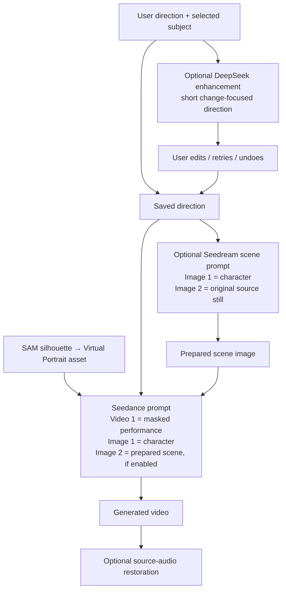

# Higgsfield Genjutsu: public prompting research

Reviewed 2026-11-06. These are public product instructions, API examples and client code. No reviewed source publishes Genjutsu's private inference/system prompt or establishes its underlying model, masking pipeline or internal prompt-rewriting implementation. Seed Genjutsu continues to use its own Meta/BytePlus pipeline.

## What is actually published

| Primary source                                                                                                                                                               | Observed behavior                                                                                                                                                               | Implication for this studio                                                                                                                                   |
| ---------------------------------------------------------------------------------------------------------------------------------------------------------------------------- | ------------------------------------------------------------------------------------------------------------------------------------------------------------------------------- | ------------------------------------------------------------------------------------------------------------------------------------------------------------- |
| [Current Object Swap API](https://open.higgsfield.ai/models/higgsfield/genjutsu/object-swap/v1.0/api-reference)                                                              | The prompt is optional and defaults to an empty string; the video and images are separate inputs.                                                                               | References carry substantial direction. A long prose description is not a prerequisite. This does not mean the server has no internal instructions.           |
| [Public workflow example](https://open.higgsfield.ai/models/workflows/genjutsu/object-swap/playground)                                                                       | Its sample prompt is the short swap instruction quoted below.                                                                                                                   | This is an example submitted by a client, not a disclosed hidden system prompt. The workflow wrapper and current model API have different published defaults. |
| [Genjutsu help](https://higgsfield.ai/creator-hub/help-center/tools/how-do-i-use-genjutsu)                                                                                   | Object Swap targets a selected element; Motion Transfer can rebuild the cast/scene around source movement and camera work. Prompts are optional and can add specific direction. | State the subject and change boundary. Do not mix localized replacement with unconditional whole-scene restyling.                                             |
| [Official launch guide](https://higgsfield.ai/blog/higgsfield-genjutsu)                                                                                                      | References, source motion and the selected editing mode drive the workflow; wardrobe, character and scene changes are distinct uses.                                            | Explicit outfit/accessory exceptions and requested scene changes matter more than generic cinematic wording.                                                  |
| [Official public agent guidance](https://github.com/higgsfield-ai/skills/blob/27000402070db19d958789d05b3b52b6f4718d7c/higgsfield-generate/references/prompt-engineering.md) | General editing guidance favors describing the change instead of narrating the input, with compact prompts.                                                                     | Keep our enhancer brief and avoid inventing unseen contents. This guide is general, not Genjutsu's internal prompt.                                           |
| [ComfyUI's Higgsfield partner node](https://github.com/Comfy-Org/ComfyUI/blob/master/comfy_api_nodes/nodes_higgsfield.py)                                                    | The Motion Transfer node defaults its prompt to empty and passes the supplied prompt into the request.                                                                          | This public adapter does not add an LLM rewrite or reveal what Higgsfield does internally. It is separate from Comfy Openjutsu.                               |
| [BytePlus video-generation API](https://docs.byteplus.com/en/docs/modelark/create-video-generation-task-api)                                                                 | Video and image reference roles are explicit; Seedance 2.5 supports a dedicated editing task.                                                                                   | Preserve our actual provider contract, rather than copying Higgsfield-specific reference markup or limits.                                                    |

The workflow's exact published example, including its spelling:

> swap the video's main character to the attached characters and his clother

The current raw Object Swap API instead demonstrates an empty prompt. Neither example proves what instruction, if any, the remote service supplies behind the API.

A [creator's documented Object Swap experiment](https://macolabs.dev/en/blog/higgsfield-genjutsu-character-swap-tutorial) separately uses a longer subject-specific instruction with explicit preservation boundaries. It is that creator's submitted recipe, not an official server prompt. Its claims about inheriting facial/lip performance cannot be assumed for our silhouette input, which removes that detail.

## Changes made

Three prompt boundaries are kept distinct:

- **Selected subject reaches Seedance.** Previously, the subject label reached SAM and Seedream but the final video builder only said selected person. The worker now passes the original target description to the final prompt and identifies the gray silhouette as the replacement area.
- **Explicit changes override defaults.** Source motion/camera/scene preservation remains the default. A requested background, camera or action change takes precedence. The character reference supplies identity and appearance; keeping source clothing/accessories overrides the default reference outfit. Other people and unrelated objects stay unchanged unless requested.
- **Image-stage names have an explicit mapping.** Seedream receives character then source still. Video instructions are interpreted in that context; the prepared scene is the output being created. The former global replacement of `Video 1` could corrupt literal shirt/sign text. Direction text is now preserved verbatim as a JSON string, with the stage mapping stated separately.
- **Enhancement stays compact and grounded.** The output target is 25–70 words, with more room for complex constraints. It names the target/reference, retains requested exceptions and quoted text/language, and avoids inventing materials, settings or a negative checklist. Requested locations are changes, not observations of the source. Image 2 is optional and only available with scene preparation.
- **Retained accessories have an explicit owner.** A live browser run exposed an ambiguous watch reference; the enhancer now attributes retained original clothing/accessories to the selected source subject, rather than the replacement character. It also avoids narrowing a full character replacement to face/hair alone.
- **Mode and reference contracts remain explicit.** Seedance 2 recreates from reference performance; 2.5 uses the dedicated editing request. The scene image is an additional `reference_image`, not a native first frame. No Higgsfield provider, proprietary markup, extra model call or LoRA was added.
- **Audio is handled separately.** Enhancement does not invent audio. The Keep original audio control now explains that it restores the source soundtrack after generation; disable it for newly requested dialogue/audio to remain in the delivered clip.

The JSON delimiter preserves literal direction text and makes the reference mapping explicit. It is not a security boundary or a guarantee that a generative model will obey every instruction.

## Qualification limits

The gray-filled subject retains a visible silhouette, not original facial details or clothing texture. Instructions cannot recover absent evidence. Retaining original clothing/accessories is better grounded when optional scene preparation provides the unmasked source still. New camera/action requests can also conflict with using source motion as a reference; a prompt alone cannot guarantee their execution.

Full-frame generation can change background pixels, miss identities, drift under occlusion or alter timing. No claim of pixel-exact preservation, exact lip synchronization, or equivalence to Higgsfield is made. Multi-person and demanding motion quality require representative footage, not just textual prompt checks.

## Live validation

Environment: local production Next.js server on loopback port 3107, restarted with the revised code; separate worker restarted with the new subject binding. Real BytePlus APIs were used without intercepting or mocking responses.

- All 25 focused tests, lint, TypeScript and production build pass. The provider contracts now protect subject propagation, conditional Image 2, exact preservation of quoted direction text and the image-stage reference mapping. Existing AI SDK tests cover the actual wire format, one submission, errors, cancellation and retry boundaries.
- Eight identical cases were run before and after through `POST /api/prompts/enhance`, all HTTP 200 with real DeepSeek output. They cover a simple swap, source outfit/watch exception, a particular person in a multi-person clip, a new snowy setting, literal `Video 1` text, Spanish dialogue, a prepared rainy street and Seedance 2 mode. Mean suggestion length fell from 75.1 to 43.4 words. The rainy street is now correctly a requested setting, not claimed source content; tested quotes and exceptions remain. This small editorial check is not a statistical benchmark or a guarantee for unseen prompts.
- Real endpoint boundaries still reject malformed input with 400 and a foreign origin with 403 before provider submission. Browser Enhance/Retry/Undo were exercised against the production backend; retry changed wording and Undo restored the exact original. The accessory-origin clarification was then re-evaluated with the same eight cases.
- The final browser direction explicitly keeps the source dancer's watch. The editor fits 390px and 320px widths without horizontal overflow; the browser console is clear and viewport sizing was reset afterward.
- A real Seedream 5.0 Pro request using the new still prompt produced a 2816×1584 image. Visual inspection confirms the requested blue wall, replacement android/lavender jacket, source-like framing and pose, and literal `Video 1` jacket text. Pixel-exact floor/background preservation was not measured.
- A four-second, 480p Seedance 2.5 comparison reused the same existing masked asset, character and prepared scene. The old prompt produced a video. The revised prompt's task reached a terminal provider rejection, `OutputAudioSensitiveContentDetected.PolicyViolation` (HTTP 200 task query with an error). No usable new video was returned, and no automatic resubmission or moderation workaround was attempted. **The video-quality comparison is incomplete.** The provider does not identify the audio content or establish that the prompt revision caused the rejection. The source contains silent AAC, while this request still asks the provider to generate audio before optional source-audio restoration.

Research captures, text outputs, task receipts and evaluation artifacts are ignored under `output/higgsfield-research/`; they contain no API keys or signed reference URLs. Representative moving/occluded multi-person footage and successful post-change video review remain follow-ups.
