# Direct Meta SAM 3.1

The masking backend uses Meta Model API directly. Set `META_API_KEY` in the ignored `.env.local` and restart both web and worker. The key must have access to `sam-3.1`. No fal endpoint or SDK is required. Existing fal settings are ignored; old take records are retained.

```mermaid
flowchart LR
    P["Prepared clip · 24 fps<br/>Seedance 2: 4–15s · 2.5: 4–30s"] --> T["Private TOS + local cache"]
    T --> Refine["DeepSeek V4.1 Flash<br/>Source video + original subject description"]
    Refine -->|Clear subject| I["Video-only MP4 copy<br/>Inline data URL · 32 MiB cap"]
    Refine -->|Ambiguous, missing or unavailable| Stop
    I --> M["Meta Responses API<br/>sam-3.1 · one_bit masks"]
    Q["Original subject phrase<br/>e.g. person in a black jacket"] --> Refine
    M --> C["Private local mask checkpoint"]
    C --> F["FFmpeg<br/>Neutral subject silhouette"]
    F --> Compare["Synchronized source + red overlay MP4"]
    Compare --> AI["DeepSeek V4.1 Flash<br/>Native video verification"]
    AI -->|Pass| R["Review references"]
    AI -->|One clear correction| M
    AI -->|Uncertain or retry exhausted| Stop["Needs attention<br/>No downstream generation"]
    R --> V["TOS → Virtual Portrait<br/>Wait for Active"]
    V --> S["Selected Seedance 2 / 2.5<br/>asset://ID as reference_video"]
```



## API contract

`src/server/meta-sam.ts` sends one `POST https://api.meta.ai/v1/responses`, authenticated with a bearer key. The body uses `model: sam-3.1`, a user message with `input_text` and `input_video.video_url`, `stream: true`, and `metadata.mask_encoding: one_bit`. The worker reads the prepared local cache, recovering it from TOS if needed. FFmpeg copies the video track into a temporary MP4 without re-encoding, so mask frame indices still match the prepared clip. The worker Base64-encodes the video-only copy and removes the temporary file. The copy is capped at 32 MiB before encoding to fit Meta's 50 MB inline limit. An oversized clip stops before a model POST and asks for a shorter selection.

The official `@meta-sam/parser` decodes the Responses stream. `eventsource-parser` handles transport chunks and SSE framing. A valid terminal `response.completed` is required; partial EOF, refusals, failed events and malformed streams never advance to reference review. Requests have a ten-minute deadline and a 64 MiB transport ceiling. There are no automatic POST retries inside the adapter.

Use a brief, concrete subject phrase, such as `person in a red jacket`. Meta can return several matches for a concept. Completed empty or multi-object results now enter AI video verification, which can request one description correction. Invalid geometry, parser errors, incomplete streams, and ambiguous submissions still stop without description retries. Parser warnings alone are not segmentation failure. The app does not silently choose an arbitrary person. Occlusion or re-entry can change tracking identity and may require a shorter clip or a more specific description.

## Exactly what SAM receives

For new Character Swap takes, the saved **Subject to replace** value (`config.target`) and prepared source video first enter DeepSeek subject refinement. Its default is `person`; a more specific example is `person in a black jacket`. A ready/identified decision supplies a concise visible-attribute phrase saved in `sam_refinement.description` and `sam_target`, which SAM receives as `input_text`. The original configuration remains unchanged. Ambiguous or missing subjects stop before SAM. The character image, creative generation direction and optional direction enhancement are not sent to refinement or SAM. A post-mask verifier-authorized correction updates `sam_target` separately without rerunning the initial refinement. Downstream swap and scene-image prompts use this effective source-subject description. Existing already-masked/downstream records do not acquire a retroactive refinement call.

```json
{
  "model": "sam-3.1",
  "input": [
    {
      "type": "message",
      "role": "user",
      "content": [
        { "type": "input_text", "text": "person in a black jacket" },
        { "type": "input_video", "video_url": "data:video/mp4;base64,..." }
      ]
    }
  ],
  "stream": true,
  "metadata": { "mask_encoding": "one_bit" }
}
```

The existing short concept format follows Meta's [SAM overview](https://dev.meta.ai/docs/sam/overview). Appending edit instructions or an LLM-written paragraph would not help this model. The subject field explains the source/character distinction and the example uses visible clothing; the known sample pre-fills the matching black-jacket description. Generic `person` remains useful for single-person clips. Refinement must ground additional attributes in the source video and must not invent clothing or select an arbitrary person on unknown uploads.

Meta's [prompt guidance](https://dev.meta.ai/docs/sam/segmenting) favors concrete attributes and cautions against commands, lists, negation and positional descriptions. For example, describe the black-jacket person instead of asking to ignore a different person. All matching objects can be returned, so our single-object check remains necessary. The verifier favors visible clothing descriptions; it must preserve the intended source subject and record corrections in the activity log.

The current [client-library documentation](https://dev.meta.ai/docs/sam/client-libraries#build-box-and-point-prompts) also documents box/point object prompts, separate from text concepts. A future visual picker could identify similar-looking people more precisely. It must map the selection into the prepared clip's pixel coordinates and use object prompts without mixing in a noun phrase. This UI and mode are not implemented or qualified here. Fresh primary documentation takes precedence over older cached excerpts that describe the hosted API as text-only.

## Rendering and recovery

`src/server/sam-render.ts` places each decoded crop at its half-open source-pixel box. It follows explicit frame indices, accepts revised masks, and leaves omitted frames unmasked. The selected subject becomes a neutral grey silhouette; the surrounding RGB scene stays visible. RGB-plane composition avoids leaving the source subject's chroma inside the mask. The output is H.264 MP4 at exactly 24 fps and the prepared clip's frame count, without audio. The original prepared clip retains audio for optional final restoration.

The current normalization is approximately 720p area. Rendering accepts at most 720 frames and one million pixels per frame. Temporary PNG masks and the rendered temporary clip are removed after use, including failed renders. Disk and FFmpeg compute run locally; their performance on a full 30-second representative clip still needs measurement.

Next.js standalone tracing excludes the runtime media directory, output evidence and private environment files. These files stay outside build artifacts and must be supplied through runtime configuration or a mounted media directory. See [Next.js output tracing](https://nextjs.org/docs/app/api-reference/config/next-config-js/output).

Before the external POST, the worker persists its existing submission marker. Meta response IDs are saved as they arrive. Only a completed stream is checkpointed at `MEDIA_ROOT/sam/<take-id>.json`, through the existing private, locked, atomic file store. Rendering can recover from that checkpoint even after a crash before the submission marker was cleared. The checkpoint retains sensitive derived media and belongs in the same private backup boundary as the workspace.

An interrupted request without a completed checkpoint becomes `needs_attention`. It is not resubmitted automatically. A confirmed 429 rejection may be retried after a delay; unknown submissions and server failures require manual inspection. In-flight legacy fal takes also stop for inspection rather than being submitted to a different provider. Cancelling a take aborts the local stream/render when the worker next renews its lease; provider billing or remote completion may continue.

TOS, the optional Seedream 5.0 Pro branch, reference approval, Virtual Portrait and Seedance remain the downstream stages. A silhouette is a video reference, not a native Seedance inpainting mask; representative output quality remains an evaluation task.

## AI source-subject refinement

New Character Swap takes enter `prompt_refinement` after source preparation. DeepSeek V4.1 Flash receives only the prepared source video and original subject description, using the same pinned `SAM_VERIFIER_MODEL`, native video input, strict JSON output, disabled thinking and `SAM_VERIFIER_FPS` as the post-mask reviewer. The source video must be a prepared video of at most 50,000,000 bytes. No replacement image, editing direction, mask or previous suggestion is supplied.

The decision is `ready` or `needs_review`, with a fixed reason and a nullable short description. Only ready/identified with a valid description advances to masking. The phrase must describe the same intended subject using visible clothing or appearance, avoiding commands, negation, lists, invented details and positional-only wording. Generic descriptions fitting several subjects, missing subjects, incomplete output and provider failures stop before SAM rather than guessing or silently falling back. Both ModelArk and Meta keys must be configured before a new paid refinement request; this avoids spending on refinement when masking is not configured.

`sam/<take-id>.json` stores `refinementStartedAt` before inference and the completed refinement report before the leased workspace transition. The report is bound to the original description, prepared-video ID and pinned model. Cached results recover without another request; interrupted submissions without a result require usage inspection. Cancellation and expired leases cannot advance into SAM. Approval/submission requires the matching usable refinement as well as the matching passed mask report for new takes. Historical already-masked/downstream takes retain their existing path without a retroactive pre-SAM call.

## AI video verification

Character Swap enters `mask_verification` after rendering and before optional Seedream, reference approval, Virtual Portrait, or Seedance. This is mandatory even with `reviewBeforeGeneration: false`. The other three workflows do not call SAM or the verifier. Existing accepted provider tasks and downstream historical records are not resubmitted or retroactively verified.

Both pre-SAM refinement and post-SAM review default to BytePlus `deepseek-v4-1-flash-261017`, configured separately from direction enhancement with `SAM_VERIFIER_MODEL` and authenticated by the existing `BYTEPLUS_API_KEY`. Activate the model's video and structured-output access before live use. A configuration-ready capability does not prove entitlement or inference success.

FFmpeg builds one silent, synchronized H.264 MP4 with the original on the left and a translucent red mask overlay on the right. Both panels use the same prepared frames; omitted masks are never propagated. Empty and multi-object masks can be rendered for inspection, but are not eligible for generation. The comparison fits within 1920x720, uses bounded encoding bitrate, is checked against a 50,000,000-byte limit, and is stored privately through the existing TOS/cache path.

`src/server/sam-review.ts` sends one native `video_url` input to `/chat/completions`, with `thinking.type: disabled`, strict JSON Schema output, and a 600-token output limit. `SAM_VERIFIER_FPS` defaults to 2 and accepts 0.2-5. Provider video processing samples frames; the verifier cannot establish frame-by-frame correctness. It receives only the comparison, original/current source descriptions, and deterministic mask statistics, never the replacement image or creative direction.

The validated decision contains `decision` (`pass`, `retry`, `needs_review`), a fixed `reason`, `subjectIdentified`, and an optional short corrected `description`. Free-form provider messages, URLs, control characters, empty descriptions, refusals, truncated output and malformed JSON cannot become retries.

- Pass requires one usable foreground object, a clearly identified subject, and a consistent pass/matched decision. Approval revalidates that the report belongs to the current mask, model, attempt and effective target.
- Retry is allowed only for completed empty masks, multiple subjects, or a clearly wrong subject, with an identified unchanged intended person and a materially different short phrase. There is at most one corrective SAM attempt per take.
- Partial masks, ambiguous subjects, exhausted corrections, and unavailable or invalid verifier output stop at `needs_attention`. Inspect **Mask Check** and the activity log, then edit the source-subject description for a new take. There is no automatic bypass into scene-image or video generation.

Each mask attempt has a private checkpoint: `sam/<take-id>.json` for the original and `sam/<take-id>.retry-1.json` for the correction. Each retains its response ID, raw completed masks, rendered media IDs, statistics, verifier submission marker, and completed decision. The verifier call has no hidden retries. A saved decision recovers its next transition without inference; a submission marker without a decision requires ModelArk usage inspection. The workspace pins the verifier model and stores at most two reports. Lease checks and the atomic correction transition prevent duplicate retries; cancellation preserves accepted evidence without advancing.

A new take passing its initial mask uses one SAM call and two DeepSeek calls: source refinement and mask review. A corrected take uses two SAM calls and three DeepSeek calls; only SAM and mask review repeat, not source refinement. Confirmed SAM HTTP rate-limit rejections retain the existing delayed-rejection handling, but uncertain/incomplete SAM requests never enter the description-retry path. Both DeepSeek steps have no hidden retries, including rate-limit failures.

The refinement and verifier are covered by offline native-request, rendering, intent binding, retry, cancellation, and crash-recovery tests. Those checks do not establish real DeepSeek video inference, accurate subject refinement, reviewer accuracy, or a tracking-quality improvement. Live evaluation on crowded, occluded, fast-moving and empty clips remains required.

## Live transport correction — 2026-11-06

The first actual TOS-backed take failed with `400 media_url_not_fetchable`. A direct signed GET returned the valid MP4, while Meta could not fetch that URL. The precise cause of Meta's fetch failure is unknown. New takes use the documented inline video format without any automatic URL-to-inline inference retry. Confirmed rejected test requests were followed by a separate explicit new take.

The corrected four-second take completed hosted SAM 3.1: 96 mask records covering all 96 frames, one tracked object, zero parser diagnostics and a persisted completed checkpoint. FFmpeg produced a four-second 1280×720 masked MP4. Chrome reference review and start/end frames show the subject silhouette with the gallery retained. Virtual Portrait subsequently accepted the video and returned Active. These results qualify this short fictional sample, not full 30-second tracking or occlusion quality.

Meta HTTP errors now retain the HTTP status and provide specific billing or inaccessible-media guidance without exposing provider response messages, signed URLs or account details.

## Validation boundary

Focused tests use deterministic synthetic masks and a local HTTP SSE fixture. They cover the request contract, response IDs, chunk splitting, rejected/partial requests, mask placement, missing frames, revisions, exact frame count and ambiguous subject rejection. Runtime smoke checks use the actual local web server and worker with credentials unset, including recovery of a synthetic completed checkpoint into an encoded MP4 and persisted reference review. The fixture checks remain separate from the live four-second evidence above. Neither establishes full-duration quality across varied footage.

## Live subject-phrase review — 2026-11-06

The production UI created a variation using `person in a black jacket`. The real worker called Meta, checkpointed its completed response, rendered a 1280×720 four-second silhouette and persisted reference review. The target and mask survive browser refresh, and the mask plays without a media error. No Seedream or Seedance generation was submitted for this check; the take remains ready for reference review.

The earlier `person` run used the identical prepared MP4 (matching SHA-256). Both runs contain 96 mask records for all 96 frames, one tracked object and zero parser diagnostics. Sampled mask agreement at frames 0, 48 and 95 is 99.57%, 99.69% and 99.76% intersection-over-union. This compares two model outputs, not ground truth: the more descriptive phrase retained the intended single person, but the result does not establish a quality gain or qualify crowded/occluded footage.

All 25 focused tests, lint, types and the production build pass. Browser checks include the persisted review, actual video playback, console diagnostics and visible subject guidance at measured 390px and 320px CSS widths without horizontal overflow. No new test was added for this guidance-only UI change. Evidence is ignored under `output/sam-prompt-review/` (`comparison.json`, `ui-proof.json`, masked video/frame and desktop/mobile screenshots).

## Primary sources

- [Meta SAM 3.1 model and pricing](https://dev.meta.ai/models/sam-3-1).
- [SAM request format and inline video](https://dev.meta.ai/docs/sam/segmenting).
- [Meta file handling and inline limits](https://dev.meta.ai/docs/file-handling).
- [Frame, object and mask output semantics](https://dev.meta.ai/docs/sam/reading-segmentation).
- [Official TypeScript parser](https://dev.meta.ai/docs/sam/client-libraries).
- [BytePlus native video inputs and size limits](https://ai.byteplus.com/ark/region:ap-southeast-1/docs/video-understanding#8e3a48ed).
- [BytePlus structured output](https://ai.byteplus.com/ark/region:ap-southeast-1/docs/structured-output-beta).
