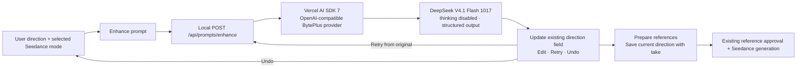

# Prompt enhancement

Implemented on 2026-11-06 for the local, single-user Seed Genjutsu studio.

The user enters a short direction and clicks **Enhance prompt**. The suggestion replaces the text in the existing direction field, ready to edit before creating a take. An **Enhanced** indicator, **Retry** and **Undo** sit beneath it. There is no popover, modal or extra acceptance step. Retry rephrases the original direction rather than repeatedly expanding the enhanced version. An identical response reports an error and keeps the current text.

Undo restores the exact pre-enhancement text while the applied suggestion is unchanged. Manual edits show **Edited** and hide Undo to protect newer work; the next enhancement then starts from the edited direction. Users can keep typing during a request. A response is discarded if the direction, subject, model or scene/audio settings changed while it was running. Cancel aborts the request and ignores late responses. Take submission and New take wait until enhancement finishes or is cancelled. Saved takes lock enhancement with their other generation settings.

The inline toolbar wraps at narrow widths. Loading, provider failures and unavailable configuration have explicit states, and errors leave the current direction intact.

## Product research

Reviewed primary product documentation on 2026-11-06:

- [Runway: Enhancing your Prompts](https://help.runwayml.com/hc/en-us/articles/50012632982163-Enhancing-your-Prompts) places enhancement beside the prompt and asks users to review and edit before generating.
- [Adobe Firefly: Enhance your prompt for video generation](https://helpx.adobe.com/firefly/web/work-with-audio-and-video/work-with-video/enhance-your-prompt-for-video-generation.html) exposes the enhanced text, editing and access to the original version.

Seed Genjutsu uses in-place replacement with review/edit before the separate generation action, following these inline patterns. Enhancement is opt-in and separate from video generation.

A later [Higgsfield Genjutsu research pass](higgsfield-prompt-research.md) distinguishes public example prompts from undisclosed internal instructions. It informs the compact change-focused wording, explicit selected subject, stage-specific reference names and precedence of requested changes over preservation defaults.

## Model and data flow

The default text model is **BytePlus DeepSeek V4.1 Flash 1017**, `deepseek-v4-1-flash-261017`, with thinking disabled. **Vercel AI SDK 7** calls it directly through `@ai-sdk/openai-compatible`, using the existing server-only `BYTEPLUS_API_KEY` and regional ModelArk base URL. No OpenAI key, Vercel key or AI Gateway is involved. `PROMPT_ENHANCER_MODEL` can override the binding with a compatible ModelArk endpoint; its service must be activated for the API key's account.

`createOpenAICompatible({ name: "byteplus", supportsStructuredOutputs: true, ... }).chatModel(modelId)` supplies the model to `generateText`. `Output.object` and a Zod schema validate the structured response. Provider options set `thinking: { type: "disabled" }` and strict JSON Schema output. `maxRetries: 0` overrides the SDK's default retries, preserving one billable submission per explicit click. Axios and TanStack Query still handle the browser-to-local-API boundary.



Only direction text, selected model, subject label, scene-preparation setting, audio setting and an optional previous suggestion are sent to the text model. Uploaded video/image files, signed URLs and asset IDs are outside this request. The model binds requested outfit/appearance details to the replacement character and is instructed not to claim it inspected media, invent unseen appearance details, add unwanted camera/scene/action changes, or promise exact reference-frame matching. It aims for 25–70 words, preserving explicit exceptions and quoted text. Requested new settings are changes, not observations of the source. The video builder also supplies source-preservation defaults, explicitly subordinate to the user's changes, and identifies the selected subject in the masked reference.

Seedance 2 receives reference-generation wording; 2.5 receives direct editing wording. Image 1 denotes the replacement character, Video 1 the performance, and Image 2 is mentioned only when optional scene preparation is enabled. Suggestions update the field without starting generation; the user reviews and can edit or undo them. Output quality remains an editorial judgment.

## API contract

`POST /api/prompts/enhance` accepts:

```ts
{
  prompt: string;        // 3–3000 characters after trimming
  model: "seedance-2" | "seedance-2.5";
  target: string;        // 1–160 characters
  prepareImage: boolean;
  preserveAudio: boolean;
  previousPrompt?: string; // retry context; original prompt stays unchanged
}
```

It returns `{ enhancement: { prompt, model, simulated: false } }`. Accepted output must contain 10–3000 characters. The provider response must finish normally and contain valid JSON. The AI SDK validates the structured output, and the application enforces editorial bounds and normal completion. Only the validated `prompt` field crosses the response boundary; unrelated provider metadata is discarded.

Requests use the existing loopback/origin checks and validated Axios client. Each explicit enhancement/retry makes one ModelArk POST, with a 30-second deadline, a 1,000-token output cap, no automatic retries and no model fallback. One request can be in flight per local web process. Missing credentials or an unactivated model return 503, invalid input 400, a concurrent request 409, upstream rate limits 429, malformed/refused/incomplete output or provider errors 502, and a deadline 504. A cancelled request is abandoned and late responses cannot replace editor state. A remote service may still finish or bill a request after cancellation.

The original direction and enhancement status stay in the current browser session. Enhancement updates the form; the existing take-creation path saves the current direction when submitted. No database or extra history service was added.

## Preview and validation

The opt-in `/preview` endpoint provides simulated suggestions without provider calls. Its Scenario control selects success or a provider failure; an inline Preview label identifies simulated suggestions. Both real and preview clients use the same request/response schemas and inline component.

Focused tests protect model/mode routing, the original-versus-previous retry boundary, complete and bounded output, metadata projection, refusal/truncation handling, single submission, concurrent-request rejection, cancellation, identical retries and sanitized provider errors. Real local endpoint checks and browser flows are recorded in [validation](validation.md); the SDK migration artifacts are ignored under `output/ai-sdk-deepseek/`.

## Primary API references

- [ModelArk Chat API](https://docs.byteplus.com/en/docs/modelark/chat-api): messages, completion status and structured output.
- [ModelArk model list](https://docs.byteplus.com/en/docs/modelark/model-list): DeepSeek V4.1 Flash 1017 and supported output capabilities.
- [Deep thinking configuration](https://docs.byteplus.com/en/docs/modelark/deep-thinking): explicitly disabling thinking.
- [Seedance generation API](https://docs.byteplus.com/en/docs/modelark/create-video-generation-task-api): reference roles and 2.5 editing mode.
- [AI SDK OpenAI-compatible providers](https://ai-sdk.dev/providers/openai-compatible-providers): direct provider configuration.
- [AI SDK structured output](https://ai-sdk.dev/docs/ai-sdk-core/generating-structured-data): `generateText` with `Output.object` and schema validation.
