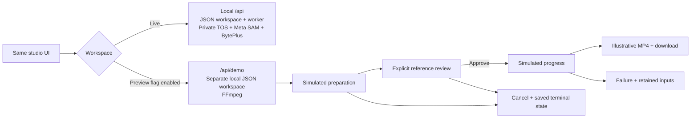

# Interactive preview and UI review

The original preview was reviewed on 2026-11-05 in Chrome against the running application. The preview shares the live studio layout and dark theme.

## Experience changes

- Paired sample media fills the empty canvas. The studio uses black and charcoal surfaces, with BytePlus blue for primary actions, selected controls and progress. The BytePlus mark sits beside the studio name and identifies the provider in the model picker.
- Persistent primary actions keep preparation, approval and download within reach. On phones, Inputs, Canvas and Your takes separate the workspace.
- Sample settings holds the outcome selector and the link to the live studio. Completed sample takes use a short **Sample result** heading.
- Preparation stops at an explicit review gate. The optional scene look is visible alongside the source and subject before approval.
- Progress, saved activity, cancellation, failure recovery and uncertain provider submission each have distinct explanations. Cancel remains available at review.
- Saved takes support search, Ready and Needs attention filters, empty-search recovery, and reopening completed media. Create a variation preserves references and direction; New take clears them.
- Upload replacement disables submission until media is ready. Number fields accept intermediate keystrokes before clamping on blur. Source time is offset to the selected trim during comparison, and both players follow the result controls.
- Loading placeholders avoid a misleading signed-out or empty-state flash while connections and the saved take load. Dialogs scroll within short screens, and native controls use a dark color scheme.

## Preview boundary

Enable with `DEMO_ENABLED=true` and restart the web process. It defaults to false. Both `/preview` and `/api/demo/*` return 404 when disabled; the live studio remains available.

Mock HTTP routes implement capabilities, samples, uploads, media ranges, jobs, approval and cancellation. X-Recast-Scenario selects success or failure only on the mock create route. Live and preview query keys and file indexes are distinct. Both are local and single-user, with no login or session cookie. A preview media UUID is not a real-studio reference.

Uploads are actually decoded and probed. Selected clips are actually trimmed, normalized and given a first frame. The mock subject is the trimmed source; it is **not SAM segmentation**. The optional scene image and final output come from fixed fictional samples. Uploaded identity, subject motion, masking quality, scene consistency, audio restoration, provider review, model entitlement, real TOS and billable generation are not validated by this preview.

Character Swap displays **simulated Refine and Verify stages** before masking and before reference review respectively. Their activity explicitly states that no DeepSeek inference, subject identification or mask-quality assessment occurs, and they do not create real refinement/verification reports. Edit Elements, Motion Transfer and Restyle skip both stages. The live source/red-mask comparison and decision rendering have automated markup tests; browser playback and measured mobile layout for these new elements remain unvalidated.

The preview saves one local workspace under MEDIA_ROOT/demo/local. JSON writes use the same inter-process lock and atomic publication as the real studio. Every browser on this computer sees the same preview library. Takes survive page refresh and web-process restart without cookies. Per-workspace limits bound the sample catalog; automatic retention cleanup is deferred. Legacy per-session folders are preserved but are no longer read.

## Computer-use evidence

The browser used actual mock HTTP endpoints without network interception. Checked journeys:

1. Load the fictional example from the live studio, select a one-second offset and four-second duration, prepare with scene look enabled, inspect Subject and Scene look, approve and reach a saved result.
2. Play synchronized comparison and download the MP4. FFprobe confirms the browser download is four seconds. Source playback follows the selected offset; result playback stops at its end.
3. At 390px, upload the actual mock MP4 and character JPG through the file chooser, skip optional scene preparation, reach review, approve a simulated failure and recover its retained inputs.
4. Upload an 18-second fixture, type a 12-second duration naturally, prepare and cancel at review. Refresh shows the persisted Cancelled state.
5. Filter Ready and Needs attention, search for no matches, clear filters, and reopen the completed result. Refresh a completed deep link on mobile and land in Canvas.
6. Open connections at 320px. The dialog remains within the viewport and scrolls; the page has no horizontal overflow. Reset the browser viewport after checks.
7. In the production build, create a variation from a completed take and replace its video. Prepare remains disabled with an Uploading references label until the replacement is ready; the previous clip cannot be submitted during that interval.

Local JPEG evidence lives under `output/ux-review/`: desktop result, desktop comparison, mobile result and mobile inputs. These QA files are ignored by Git. Sample media is retained locally for manual review.

## API and build validation

- ESLint, TypeScript and the Next.js production build pass. Twelve focused regression tests pass, including review gating, optional scene handling, terminal states, cross-process file writes and corrupt-state protection.
- `npm run smoke` passes against the standalone web server and worker with no database running. It checks cookie-free access, removed auth routes, local request guards, real media upload/FFmpeg persistence, history, quotas, approval, cancellation and interrupted-submission handling. No paid provider is called.
- `npm run demo:smoke` passes against the production mock routes: packaged sample files, actual image upload, invalid video rejection, trim validation, review gating, duplicate approval, success, failure, cancellation, range reads, foreign-origin rejection, separate real/preview indexes, and a valid four-second result download.
- Disabled-preview checks return 404 for /preview and /api/demo/jobs while /api/jobs remains available without login.
- Production dependency audit reports zero vulnerabilities. Final computer-use inspection found no new application console errors; the retained browser log contains older extension-generated errors.

The standalone copy step must merge public files into the destination rather than nesting `public/public`. CI uses `cp -r public/. .next/standalone/public/`; sample-asset HTTP checks protect this packaging boundary. Docker copies the public directory contents into its runtime public folder.

## Sample asset provenance

Both still images were created with the **built-in image generation tool** for this UI review. The subject is fictional. The edit used the generated performer image as its target. These are not Seedream or Seedance outputs.

Saved project assets:

- `public/samples/source.jpg`: source performance poster.
- `public/samples/character.jpg`: illustrative android look and result poster.
- `public/samples/source.mp4` and `result.mp4`: six-second, 1280×720, 24 fps H.264/AAC fixtures with coordinated gentle camera movement and silent audio, encoded with FFmpeg from the stills.
- `output/imagegen/source.png` and `character.png`: original stills, excluded from Git as QA working files.

### Source generation prompt

Use case: photorealistic-natural. Asset type: landscape sample footage still for a polished private video character-swap studio. Create a cinematic editorial photograph, 16:9 landscape. A fictional adult male contemporary dancer, late twenties, short dark hair, wearing a loose charcoal jacket, slate-grey tee and wide black trousers, in a confident dynamic dance pose, left arm extended sideways and right arm bent upward, framed from head to below knees. Full subject stands just right of center. Background is a beautiful minimalist brutalist gallery with warm ivory travertine walls, a broad archway and one shaft of late-afternoon sunlight, soft architectural shadows. Subtle film grain, natural skin texture, sophisticated warm-neutral color grade, restrained teal from the shadow areas, shot on a 50mm lens with photographic realism. Clean composition and enough visible background to demonstrate scene preservation. No text, no logos, no lettering, no collage, no panels, no UI, no watermark. This is an illustrative fictional source reference for UI testing.

### Character edit prompt

Use case: precise-object-edit. Asset type: illustrative character-swap sample result for a private video studio UI. Edit the provided fictional dancer photograph. Replace only the human performer with a beautiful elegant humanoid android: sculpted pearlescent ivory and brushed titanium face, subtle luminous pale-violet eyes, slim athletic proportions, wearing an oversized muted lavender technical jacket and wide charcoal trousers. Maintain exactly the dancer's position, full body stance, raised bent arm and extended other arm. Keep the gallery architecture, travertine textures, archway, camera framing, sunlight direction, shadows and warm photographic color grade exactly unchanged. Android should be premium cinematic production design and physically present with believable materials and contact shadows. No other characters, no effects, no text or logos, no split panels, no watermark. Output landscape same framing as original. This is a fictional illustrative mock result, not evidence of an actual video model run.

## Follow-up

See [live validation](validation.md) for Meta SAM 3.1, Virtual Portrait, private TOS, Seedance and Seedream results. The current local-only version is checked using the standalone server and worker. The earlier container smoke check covered the PostgreSQL prototype.
