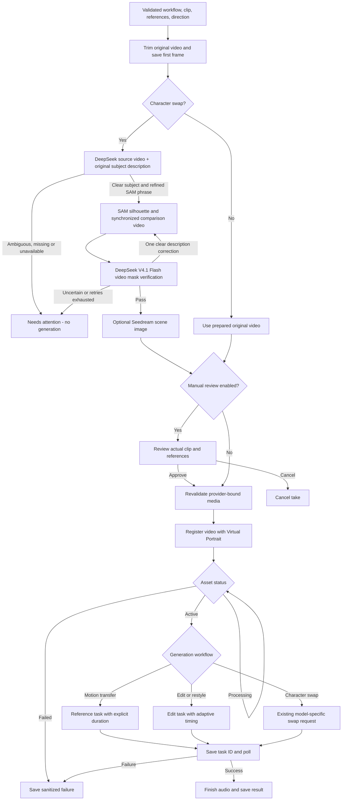

# Video Transformation Workflows

Seed Genjutsu supports **Character Swap**, **Edit Elements**, **Motion Transfer**, and **Restyle**. New workflows use Seedance 2.5; legacy swaps keep the existing Seedance 2/2.5 choices.

These are application workflows over BytePlus APIs, not new models or a guarantee of Higgsfield parity. One watercolor sample has passed live integration testing; local style presets remain versioned creative directions, not generally qualified effects.

## Inputs And Review

| Workflow        | Image references                                                      | Video preparation                                                                                               |
| --------------- | --------------------------------------------------------------------- | --------------------------------------------------------------------------------------------------------------- |
| Character Swap  | One required character image                                          | Trim, AI subject refinement, SAM tracking, gray silhouette, AI mask verification, optional Seedream scene image |
| Edit Elements   | Optional object, garment, identity, character, scene, or style images | Trim and normalize the original video, without SAM                                                              |
| Motion Transfer | At least one character, identity, or scene image                      | Trim and normalize the original movement donor, without SAM                                                     |
| Restyle         | Optional style images; choose a local preset or custom direction      | Trim and normalize the original video, without SAM                                                              |

Element editing supports replace, add, remove, and modify operations. Wardrobe changes are element edits with garment references; the instructions retain the source identity unless replacement is requested. Text edits preserve quoted wording in the submitted prompt, but generated typography is not guaranteed to be exact.

Reference order defines **Image 1, Image 2, ...** in both enhancement and generation. Roles define how the model should interpret each image. New workflows allow at most 30 references and reject duplicate image IDs, unknown roles, and missing media records.

At review, new workflows show the **prepared original video**, not a masked performance. Review the clip, reference order/roles, and style settings before approval. Optional Seedream scene preparation remains character-swap-only.

## Routing

This view follows [`scripts/worker.ts`](../scripts/worker.ts), [`approveJob` and `validateSubmission`](../src/server/jobs.ts), and the [`transformationRequest`](../src/server/generation.ts) builder.



## Virtual Portrait And Real People

All workflows retain the existing Virtual Portrait path:

1. Register the masked performance for a character swap, or the prepared original clip for a new workflow.
2. Poll the asset until it is Active.
3. Submit its `asset://` reference to Seedance.

There is no new real-person onboarding or authorization verification process in this release. AI refinement and verification concern source-subject selection and the subject mask, not authorization. **Active is a provider processing status, not evidence of verified real-person authorization.** BytePlus documents eligibility restrictions and authorized-asset requirements for real-face references. The app does not remove those requirements or guarantee that an AIGC asset registration is sufficient. Provider registration, moderation, task-type, or eligibility failures stop the take with a sanitized error; interrupted submissions are not blindly repeated.

Image references are sent through the existing image-reference transport. Registering the video does not establish eligibility of every supplied image. Follow the provider's real-person requirements for both modalities.

## API

Existing job endpoints remain:

- `POST /api/jobs`
- `GET /api/jobs`
- `GET /api/jobs/{id}`
- `POST /api/jobs/{id}/approve`
- `POST /api/jobs/{id}/cancel`

Discovery endpoints:

- `GET /api/capabilities` includes workflows, configuration readiness, supported image counts, and SAM requirements. Configuration readiness is not an account-entitlement or quality claim.
- `GET /api/presets?workflow=restyle` returns local preset IDs, revision, label, direction, and `qualityValidated: false`.

New Character Swap jobs include mandatory `prompt_refinement` before SAM and `mask_verification` before prepared-reference review. Both use the same pinned DeepSeek V4.1 Flash video model. `job.samRefinement` holds the source-refinement decision, original description, refined SAM phrase, prepared-video ID, model and token usage when returned. `job.maskComparison` is the synchronized source/red-overlay MP4; `job.maskVerifications` retains up to two structured reports, attempt numbers, effective source phrases, model binding and token usage when returned. The original `job.config.target` is unchanged. Non-swap and older jobs may omit those fields.

Ambiguous/missing subjects or failed refinement stop before SAM. Empty, multiple-object or clearly wrong masks may receive one automatic description correction only when the same intended source subject is identified. Initial source refinement is not repeated on that correction. Uncertain subjects, partial masks, failed verifier requests and exhausted corrections stop at `needs_attention`, without optional scene generation, registration or Seedance submission. Approval and submission bind usable source refinement to the original description/prepared clip and the passed mask report to the actual current mask. See [AI source refinement](meta-sam.md#ai-source-subject-refinement) and [AI video verification](meta-sam.md#ai-video-verification) for configuration, cost and recovery boundaries.

An element edit without replacement images:

```json
{
  "workflow": "element_edit",
  "model": "seedance-2.5",
  "sourceId": "55b92e55-ec29-4d6a-89d3-46befd9b94df",
  "operation": "modify",
  "target": "the jacket worn by the person on the left",
  "prompt": "Change the jacket to red; retain the person's identity and source motion.",
  "references": [],
  "start": 0,
  "duration": 4,
  "resolution": "720p",
  "preserveAudio": true,
  "reviewBeforeGeneration": true
}
```

Reference inputs use locally uploaded media IDs:

```json
{
  "id": "b643d3ca-1e81-48cd-8100-57bfb450a938",
  "mediaId": "a5b5dde8-53a6-479c-8381-2ce129dca2f8",
  "role": "garment"
}
```

The UUIDs above are illustrative. Use IDs returned by the upload API, not arbitrary media URLs or provider asset IDs.

Restyle selects `stylePreset` from `custom`, `watercolor`, `anime`, `clay`, `noir`, or `pixel_art`, with `stylePresetRevision: 1`. A preset or style-image reference can supply intent when `prompt` is an empty string. Custom direction without a style reference needs at least ten characters.

Legacy requests omit `workflow` and continue using `characterId`. Missing workflow in saved records means `character_swap`; saved model defaults and pinned provider task/model/asset IDs are preserved. Unknown fields are rejected on new-mode requests, while legacy stripping behavior remains.

## Generation And Audio

Edit Elements and Restyle use Seedance 2.5 task type `edit`, adaptive aspect ratio, and duration `-1`. Motion Transfer uses task type `reference` and an explicit output duration. Source selection remains 4-30 seconds.

When Preserve Audio is enabled, generated audio is disabled and the selected source soundtrack is restored locally. Motion/cadence changes can affect synchronization; this requires live qualification and is not guaranteed by successful muxing.

## Preview And Limits

Preview uses prerecorded sample outputs and simulated lifecycle states. It exercises workflow validation, references, approval, cancellation, and failure handling, **not** model behavior or quality.

No social feeds, motion library, third-party provider, native plugins, or general VFX catalog are included. Real generated quality, exact text, identity fidelity, temporal style consistency, cost, latency, and audio alignment require a rights-cleared evaluation set and separately approved paid generation.

## Implementation Validation

Validated on 2026-11-09: **134 automated tests**, full lint, TypeScript checking, and the production build passed. `npm run smoke` passed 95 isolated local API/worker checks plus all four simulated preview workflows. Each new live workflow prepared the original video without SAM and stopped at missing Virtual Portrait credentials before any paid call.

A fresh automated Chrome session checked video-only element edits, ordered motion references and roles, saved-input reuse, preset-only and style-image-only restyle, prepared-video review, cancellation, stale enhancement and upload protection, and 390px mobile navigation. The IDE browser extension was unavailable; installed Playwright and Chrome were used without installing dependencies. These checks do not establish provider acceptance, real-person eligibility, or output quality.

## Live Integration Validation

Separately authorized on 2026-11-09, **one four-second 480p generation for each new workflow succeeded** with `dreamina-seedance-2-5-260628`. Each used the actual upload API, private TOS, prepared-original browser review and approval, Virtual Portrait registration and Active gate, worker polling, audio finishing, and media delivery. There were exactly three distinct accepted tasks, no SAM masking, and no optional paid stages or retries.

| Workflow        | Observed Result                                                                              | Delivered Duration |
| --------------- | -------------------------------------------------------------------------------------------- | ------------------ |
| Edit Elements   | A charcoal jacket becomes red; sampled source pose and gallery are retained.                 | 3.708333 seconds   |
| Motion Transfer | The referenced fictional android and lavender jacket appear with the donor pose and gallery. | 4.041667 seconds   |
| Restyle         | The watercolor preset changes the rendering of both performer and gallery.                   | 3.708333 seconds   |

All results are 854x480 H.264/AAC at 24 FPS. Download hashes match saved results, full Chrome playback succeeds, and desktop/390px mobile result views show measured output metadata. The fictional source is an animated still with a camera glide and silent AAC. This verifies these samples and silence preservation, **not articulated motion transfer, speech synchronization, real-person authorization, all element operations, or all presets**. Adaptive edit/restyle timing was about 0.292 seconds shorter than the four-second input.

Temporary STS credentials were injected into an isolated runtime, not persisted. The owned web/worker processes were stopped; permanent configuration remains local and still requires secure TOS/portrait credentials for ordinary live use. No settled billing amount was verified. See the [sanitized live report and outputs](../output/live-core-workflows-2026-11-09/VALIDATION.md); the evidence is local and Git-ignored.

## References

- [Seedance 2.5 task and input constraints](https://ai.byteplus.com/ark/region:ap-southeast-1/docs/seedance-2-5)
- [BytePlus portrait-asset guidance](https://ai.byteplus.com/ark/region:ap-southeast-1/docs/seedance-portrait-asset-guide)
- [Video task API](https://ai.byteplus.com/ark/region:ap-southeast-1/docs/create-video-generation-task-api)
- [Feature feasibility research](../GENJUTSU_FEATURE_SUPPORT_RESEARCH.md)
